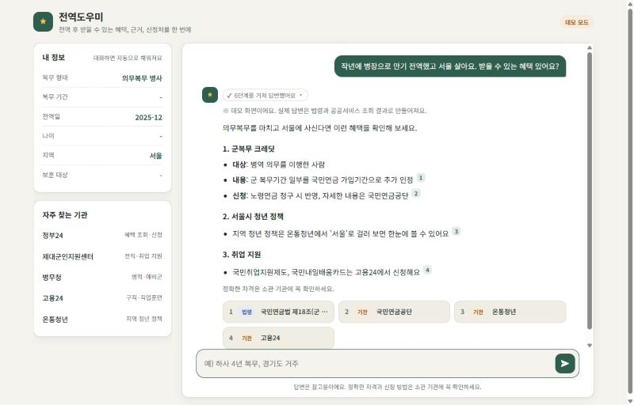
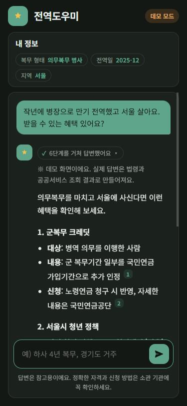

# 전역도우미 (jeonyeok_helper)

전역자가 자기 상황을 말하면 **받을 수 있는 혜택, 근거 규정, 신청처**를 한 번에 알려주는 AI 에이전트입니다.

- **규정 Q&A**: 법령, 지자체 조례, 국가보훈부 자료를 RAG로 검색해 근거 조문과 함께 답변
- **맞춤 혜택 찾기**: 복무 형태, 기간, 나이, 지역에 맞는 공공서비스 혜택 조회
- **기관 연계**: 소관 기관, 신청 방법, 링크, 연락처 안내

자세한 내용은 [기획서](docs/기획서.md)와 [개발 순서](docs/개발순서.md)를 참고하세요.

## 화면

| 데스크톱 | 모바일 (다크 모드) |
|---|---|
|  |  |

> 데모 모드 화면입니다. Gemini 키가 없으면 웹 화면이 자동으로 데모 모드로 열려 예시 응답을 보여줍니다.

## 구조

```
사용자 ─▶ FastAPI ─▶ 슈퍼바이저 (Gemini, LangGraph)
                        ├─ 프로필 에이전트
                        ├─ 규정 에이전트     (RAG)
                        ├─ 혜택 에이전트     (MCP → 공공서비스 API)
                        └─ 기관연계 에이전트
                     ─▶ 근거 검증 ─▶ 답변 (SSE 스트리밍)
```

| 영역 | 기술 |
|---|---|
| LLM | Gemini |
| 에이전트 | LangChain, LangGraph, LangSmith |
| 도구 연동 | MCP |
| RAG | Chroma, HyDE, Re-ranking |
| 서버 | FastAPI |
| 배포 | Docker, AWS, GitHub Actions |

## 폴더

```
src/jeonyeok_helper/
├─ config.py      # .env 설정
├─ llm.py         # Gemini 모델, 임베딩
├─ rag/           # 1단계: 법령·문서 수집과 검색
├─ benefits/      # 2단계: 공공서비스 API, 기관 링크, MCP 서버
├─ agents/        # 3단계: LangGraph 슈퍼바이저
└─ api/           # 4단계: FastAPI
tests/
docs/
```

## 시작하기

[uv](https://docs.astral.sh/uv/)가 필요합니다.

```bash
uv sync
cp .env.example .env   # 키 입력
uv run jeonyeok-serve  # http://127.0.0.1:8000 웹 화면
```

| API | 설명 |
|---|---|
| `POST /chat` | `{message, thread_id?, user_id?}` → SSE 스트리밍 (`thread`, `step`, `answer` / `question`, `error`, `done`) |
| `GET /profile/{user_id}` | 저장된 사용자 프로필 |
| `GET /health` | 상태, 에이전트 준비 여부, 키 설정 여부 |

규정 수집과 검색 (1단계):

```bash
uv run jeonyeok-rag laws                          # data/laws.yaml의 법령 수집 (LAW_API_OC 필요)
uv run jeonyeok-rag files                         # data/raw/ 의 PDF·TXT·MD 수집
uv run jeonyeok-rag search "군복무 크레딧이 뭐야?"   # HyDE + Re-ranking 검색
uv run jeonyeok-rag stats                         # 저장된 문서 수
```

국가보훈부 자료 같은 파일은 `data/raw/`에 넣으면 됩니다. HWP는 PDF로 변환해서 넣어주세요.

MCP 서버 (2단계):

```bash
uv run jeonyeok-mcp   # stdio로 실행
```

| 도구 | 하는 일 |
|---|---|
| `search_regulations` | 법령·보훈부 자료에서 근거 조문 검색 |
| `search_benefits` | 정부24 공공서비스(혜택)에서 전역자 혜택 조회, 지역 필터 |
| `get_benefit_detail` | 혜택의 선정기준, 구비서류, 신청방법 |
| `find_institutions` | 주제별 기관 사이트·연락처 ([data/institutions.yaml](data/institutions.yaml)) |

API 키가 없거나 호출이 실패하면 오류 대신 정부24, 온통청년 등 직접 찾아볼 수 있는 기관 링크를 돌려줍니다.

Claude Desktop 같은 MCP 클라이언트에 연결하려면 설정에 아래처럼 추가합니다.

```json
{
  "mcpServers": {
    "jeonyeok_helper": {
      "command": "uv",
      "args": ["--directory", "<이 레포 경로>", "run", "jeonyeok-mcp"]
    }
  }
}
```

에이전트와 대화하기 (3단계, Gemini 키 필요):

```bash
uv run jeonyeok-chat
```

```
start → profile(복무 정보 추출) → supervisor ─┬→ regulation / benefit / institution → supervisor
                                              ├→ ask_user (정보가 부족하면 되묻기)
                                              └→ respond(답변 초안) → verify(근거 검증)
```

테스트와 린트:

```bash
uv run pytest
uv run ruff check .
```

## 필요한 키

| 키 | 발급처 | 용도 |
|---|---|---|
| `GOOGLE_API_KEY` | [Google AI Studio](https://aistudio.google.com/apikey) | Gemini |
| `LAW_API_OC` | [국가법령정보센터 Open API](https://open.law.go.kr) | 법령, 조례 수집 |
| `DATA_GO_KR_SERVICE_KEY` | [공공데이터포털](https://www.data.go.kr) | 공공서비스(혜택) 정보 |
| `LANGSMITH_API_KEY` (선택) | [LangSmith](https://smith.langchain.com) | 실행 추적 |

## 안내

이 서비스의 답변은 참고용입니다. 실제 자격과 신청 방법은 소관 기관에 꼭 확인하세요.
