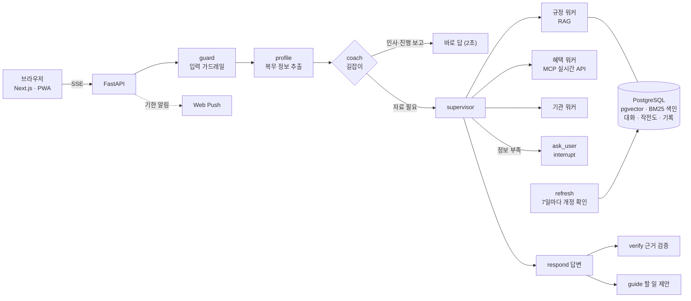

# 전역도우미

> 전역한 사람이 "나는 뭘 받을 수 있지?"라고 물으면 **받을 수 있는 혜택, 그 법적 근거, 신청할 곳**을 찾아 주고,
> 할 일 목록(작전도)과 서류 준비·기한 알림까지 이어 주는 AI 에이전트입니다. 로그인 없이 누구나 씁니다.

| 답변 평가 | 검색 골든셋 | RAGAS 근거 충실도 | 검색 자료 |
|:---:|:---:|:---:|:---:|
| **205 / 207** 문항 통과 (실패 2건은 채점 기준 보정 뒤 통과 확인) | **Hit@6 98%** (84문항) · 처음 보는 문항 85~92% | **0.879** (179문항, 채점이 흔들림) | **10,143** 조각 (법령·조례·안내서, 7일마다 자동 갱신) |

## 개선 결과: 이전 → 이후

고칠 때마다 같은 평가로 재서 **얼마나 달라졌는지** 남겼습니다. 기술마다 문제·적용 방법은 [기술 상세](docs/기술_상세.md)에 있습니다.

### 검색: 정답 조문을 더 잘 찾는다

| 지표 | 이전 | 이후 | 바꾼 것 |
|---|:---:|:---:|---|
| 처음 보는 문항에서 정답 찾음 | 87~89% | **93~96%** | 재정렬 후보 12 → 30개 |
| 정답 순위 (MRR, 1에 가까울수록 좋음) | 0.64 | **0.77** | 재정렬 점수 기준을 지시문에 구체적으로 적음 |
| 보훈·의료·교육 새 문항 30개 정답 찾음 | 87% | **97%** | 위와 같음 (MRR도 0.63 → **0.78**) |
| 골든셋 정답 재현율 (Recall@6) | 99% | **100%** | BM25 키워드 검색 추가 |
| 일상 용어 질문 (국취제·청약 등) | 96% | **98%** | 생활 용어 → 법령 용어 사전 |

개발 중에 본 문항 기준 98%는 과적합이어서, 위 수치는 새로 만든 문항으로 다시 잰 값입니다.

### 답변 품질: 지어내는 것을 잡는다

| 지표 | 이전 | 이후 | 바꾼 것 |
|---|:---:|:---:|---|
| RAGAS 근거 충실도 (나라사랑가게 목록) | 0.09 | **0.97** | 장소는 "이름: 주소, 전화"로만 적게 함 |
| RAGAS 답변 관련성 (위탁병원 목록) | 0 | **0.97** | 얼버무리지 않고 목록으로 |
| 일반 전역자에게 80세 이상 참전수당 안내 | 10번 중 2번 통과 | **6번 연속 통과** | 복무 형태를 몰라도 참전 전용 혜택 제외 |
| 답변 평가 (자료를 늘린 뒤) | 30/30 → 24/30 하락 | **30/30 회복** | 같은 문서 2개 제한, 도구 호출 강제 |
| 답변 평가 (프로필 항목을 늘린 뒤) | 41/41 → 37/41 하락 | **되돌림** | 평가가 회귀를 잡아 변경 취소 |
| 답변 평가 문항 수 | 30 | **207** | 63 → 205 → 207로 늘리며 새 결함 발견 |

### 속도: 단계별로 재고 줄인다

| 지표 | 이전 | 이후 | 바꾼 것 |
|---|:---:|:---:|---|
| 첫 화면에 내용이 보이기까지 | 약 13초 | **2.6~3.9초** | 필요 없는 프로필 추출 생략, 찾은 자료를 먼저 보여 줌 |
| 평가 평균 응답 시간 | 17.2초 | **14.2초** | 근거 검증은 고칠 문장만, 말풍선은 검증과 병렬 |
| 실제 질문 응답 | 28.2초 | **21.3초** | 위와 같음 |
| "15년 복무, 부산" 질문 | 101초 | **22초** | 직접 써 보고 찾은 지연 수정 |
| 나라사랑가게 조회 | 4.3초 | **0.2초** | MCP 응답 저장 (온통청년도 4.2초 → **0.2초**) |

### 안 돼서 고쳤더니 된 것

| 안 되던 것 | 원인 | 추가한 방법 | 결과 |
|---|---|---|---|
| "실업급여 받을 수 있어요?"에 고용보험법 조문을 못 찾음 | 벡터 검색이 "실업급여"와 법령 용어 "구직급여"를 같은 말로 보지 못함 | 생활 용어 → 법령 용어 사전, 이어서 BM25 | 골든셋 Hit **100%** |
| 자료를 늘렸더니 답변 평가 30/30 → 24/30 | 600쪽 안내서 조각이 상위를 다 차지해 법령이 밀려남, 워커가 도구 없이 답함 | 같은 문서 2개 제한, 워커는 도구 호출을 강제 | **30/30** 회복 |
| 나라사랑가게 목록에 없는 "대상·내용"을 지어 넣음 | 혜택 카드 틀을 장소 목록에도 강제 | 장소는 "이름: 주소, 전화" 목록으로 | 근거 충실도 0.09 → **0.97** |
| 일반 전역자에게 80세 이상 참전수당을 안내 | 복무 형태를 모르면 대상 거름이 꺼져 있었음 | 몰라도 참전 전용 혜택 제외, 질문에 "참전"이 없으면 참전 조례 제외 | 10번 중 2번 → **6번 연속** 통과 |
| 근거 검증이 "이 문장을 고쳐라"는데 초안에서 못 찾고 건너뜀 | 공백·줄바꿈·`**` 한 글자만 달라도 못 찾음 | 그런 차이를 무시하고 찾게 함 | 근거 없는 문장이 남을 위험 제거, 테스트 302 → **312**개 |
| 정답 조문이 후보에서 빠짐 | 재정렬 후보가 12개뿐 | 30개로 늘림 | 정답 찾음 87~89% → **93~96%** |
| 되묻고 답하면 처음부터 다시 돎 | 질문 때 그래프가 끝남 | interrupt로 멈춘 자리에서 이어 감 | 찾은 자료를 다시 검색하지 않음 |

### 해 봤더니 악화되거나 효과 없어서 되돌린 것

| 시도 | 기대 | 실제 결과 | 결정 |
|---|---|---|---|
| 프로필 추출 항목 늘림 (군·계급·목표 등) | 더 많은 정보 파악 | 답변 평가 41/41 → **37/41 하락** | 되돌림, 지키는 테스트 추가 |
| 답변 모델 생각 예산 1024 → 512 | 더 빠르게 | 시간은 14.5 → 13.6초로 줄었지만 통과 202 → **199 하락** | 1024 유지, 속도 대신 품질 |
| 재정렬 모델에 생각 켜기 | 순위가 더 정확하게 | 순위(MRR) 0.64 → **0.57 악화**, 시간 3.6 → **8.0초**로 2배 | 버림 |
| 안내서·PDF를 문서당 1쪽으로 제한 | 법령이 위로 | 정답 찾음 95% → **93% 하락** | 쓰지 않음 |
| 라우터 두 번째 호출 건너뛰기 | 시간 단축 | 205/207·15.0초 **그대로** (호출이 이미 질문당 0.89번) | 되돌림 |
| 판단 단계에 15초 시간 제한 | 느린 호출 차단 | 재시도 없이 바로 오류, 근거 검증이 빠질 위험 | 되돌림 |
| 후보를 30개로 늘려 순위도 개선 | 순위 상승 | 정답 찾음은 올랐지만 MRR은 0.64 → **0.66**으로 거의 그대로 | 순위는 지시문 점수 기준으로 따로 해결(0.77) |
| 일상 용어 사전만으로 처음 보는 문항 개선 | 새 문항도 상승 | 기존 문항 96 → 98%만 오르고 처음 보는 문항은 **거의 그대로** | 후보 수 늘리기가 더 큰 효과 |

60문항만 보고 생각 예산을 줄였다면 품질이 떨어진 걸 모를 뻔했습니다. 그래서 바꾼 뒤에는 전체 평가를 다시 돌립니다. 자세한 실험은 [평가와 비용](docs/평가와_비용.md), 실패한 일의 전체 기록은 [개발과정·실패와 결정](docs/개발과정_실패와_결정.md)에 있습니다.

### 그 밖에

- **자료 자동 갱신**: 첫 실행에서 실제 개정 **9건**을 발견·반영, 바뀐 것만 다시 임베딩
- **되묻기(Human-in-the-loop)**: 답하면 처음부터가 아니라 멈춘 자리에서 이어 감
- **안정성·보안**: 프롬프트 인젝션·개인번호 가드레일, 시간 제한·재시도, 횟수 제한

## 왜 만들었나

**전역자들은 자기가 받을 수 있는 혜택을 잘 모릅니다.** 찾아보려 해도 제대로 아는 실무자가 드물어, 결국 본인이 직접 찾아야 합니다.

저는 병사와 간부로 총 8년 반을 복무하고 전역했습니다. 전역을 앞두고 무엇을 신청해야 하는지 알려 주는 곳이 없어 애를 먹었습니다.
혜택은 법령(제대군인지원법·국민연금법·병역법…), 보훈부·국방부 안내서, 지자체 조례, 공공기관 누리집에 흩어져 있고,
병사·단기 간부·중장기 복무·보훈대상자인지, 어디 사는지, 언제 전역하는지에 따라 받을 수 있는 것이 달랐습니다.
그리고 알게 되더라도 **기한을 놓치면** 받을 수 없었습니다(전직지원금은 전역 후 6개월).

그래서 **흩어진 자료를 모아 근거(조문)와 함께 답하고, 할 일·서류·기한 알림까지 이어 주는 에이전트**를 만들었습니다.

## 할 수 있는 것

| 기능 | 하는 일 |
|---|---|
| **물어보면 근거와 함께 답** | 법령·조례·안내서·실시간 혜택 API를 찾아 답하고, 답변의 [1], [2]를 누르면 **원문(조문·쪽)과 시행일**을 바로 보여 줌 |
| **길잡이와 작전도** | 복무 형태·지역·전역일을 버튼 몇 번으로 받아 시기별 할 일(작전도)을 만들고, "했어요"를 누르면 계급이 오르며 다음 할 일을 권함 |
| **신청 서류 도우미** | "전직지원금 신청할래요" → 챙길 서류 체크리스트, 내 정보로 채운 신청 내용, 관할 보훈청, 마감일 (주요 제도 5개) |
| **기한 놓치지 않기** | 마감일을 캘린더(.ics)에 넣거나, 브라우저 알림(마감 30·7·1일 전)을 켬. 휴대폰 홈 화면에 앱처럼 설치 |
| **로그인 없이 기록 지키기** | 내 기록을 파일로 저장·불러오기, 다른 기기에서 이어 하는 코드와 QR, 브라우저 사본 |

## 화면

| 묻는 동안 찾은 자료를 먼저 보여 줌 | 답변의 [n] → 근거 원문 |
|---|---|
|  |  |

| 신청 서류 도우미 | 작전도: 캘린더·알림·서류 도우미 |
|---|---|
|  |  |

<details><summary>화면 더 보기 (첫 방문, 길잡이, 작전도, 운영 대시보드, 다크 모드, 모바일)</summary>

| 처음 온 사람: 묻거나 복무 형태를 고르면 | 버튼 몇 번으로 작전도 완성 |
|---|---|
|  |  |

| "어떻게 해요?" → 근거와 함께 답변 | "했어요" → 계급이 오르고 다음 임무 |
|---|---|
|  |  |

| 나의 전역 작전도 | 운영 대시보드 (관리자) |
|---|---|
|  |  |

| 내 정보 | 사용법 | 다크 모드 |
|---|---|---|
|  |  |  |

| 모바일 첫 화면 | 모바일 대화 |
|---|---|
|  |  |

</details>

## 구조



LangGraph 슈퍼바이저가 질문에 맞는 워커를 고르고(규정·혜택은 동시에 실행), 답변은 워커가 가져온 **도구 원문만** 근거로 씁니다.
모든 저장(벡터, 키워드 색인, 대화 기록, 프로필, API 응답, 작전도, 알림 구독, 운영 기록)은 PostgreSQL 하나에 둡니다.

## 평가와 비용 (요약)

자세한 표와 실험은 [평가와 비용](docs/평가와_비용.md)에 있습니다.

| | |
|---|---|
| **답변 평가** | 207문항 중 **205 통과**, 체크 통과율 100%(실패 2건은 채점 기준 보정 뒤 통과 확인) |
| **질문 하나** | 평균 **약 15초**(찾은 자료는 약 3초, 첫 글자는 약 12초), 모델 호출 약 7번, **약 15원** |
| **시간이 걸리는 곳** | 규정 검색 5~9초 + 답변 생각 약 5초. 생각을 줄이면 통과가 202 → 199로 떨어져 품질을 택함. 라우터 재호출 생략·시간 제한도 해 보고 되돌림 |
| **모델을 낮추면?** | 라우팅 일치 60%·프로필 87%라 **바꾸면 안 됨**. 짧은 판단 단계 셋을 합쳐도 비용의 5%라 이득도 작음 |
| **점수를 믿어도 되나?** | 검색은 개발 중 문항에 맞춰져 있었고(98% → 새 문항 85~92%), RAGAS는 채점 모델 사이에 흔들림. 그래서 사람 채점 30문항으로 확인할 계획 |

## 만들면서 실패한 것

코드는 AI 코딩 도구(Claude Code)와 함께 짰고, 저는 방향을 정하고 직접 써 보며 실패를 찾고 평가로 확인하는 역할을 했습니다. 전체 표(실패 → 제 지시 → 바뀐 것 → 결과)와 트러블슈팅은 [개발과정·실패와 결정](docs/개발과정_실패와_결정.md)에 있습니다.

- **RAG 챗봇에서 길잡이로**: "자연어로 길을 안내하는 게 가장 중요하다"는 지시로 coach 노드·작전도를 넣음
- **"좋아진 것 같다" 대신 숫자로**: 평가 데이터셋을 만들어 회귀를 잡음
- **직접 써 보고 찾은 오류**: 일반 전역자에게 80세 이상 참전유공자 수당을 안내함 → 평가 문항으로 먼저 재현(10번 중 2번 통과)하고 고쳐 6번 연속 통과
- **응답이 느릴 때**: 추측하지 않고 단계별로 재서 고침(평가 평균 17.2 → 14.2초)


## 기술 스택

| 영역 | 기술 |
|---|---|
| LLM · 에이전트 | Gemini 2.5 Flash, LangChain, **LangGraph** (슈퍼바이저, interrupt, TimeoutPolicy, 구조화 출력) |
| RAG | **PostgreSQL + pgvector**, BM25(Kiwi) + RRF, HyDE, LLM 재정렬, 개정 감지 자동 갱신 |
| 도구 연동 | **MCP** 서버 (정부24, 온통청년, 제대군인지원센터 채용, 보훈 채용, 위탁병원, 나라사랑가게, 관할 보훈청) |
| 서버 | **FastAPI** (SSE 스트리밍), SQLAlchemy 2.0 + Alembic, LangGraph Postgres 체크포인터·스토어, Web Push(pywebpush) |
| 화면 | Next.js 16 (App Router), React 19, TypeScript, Tailwind CSS 4, PWA(서비스 워커), iCalendar |
| 품질 | pytest 312개, vitest 79개, ruff, ESLint, 평가 3종(답변·검색 골든셋·RAGAS), GitHub Actions CI |
| 배포 | Docker Compose (db · api · refresh · web) |

## 실행

```bash
cp backend/.env.example backend/.env   # 키 입력 (아래 표)
docker compose up --build              # http://localhost:3000
```

AWS에 처음 올리는 순서(Lightsail 월 약 $24, 도메인·HTTPS, 끄고 다시 켜기)는 [AWS에 올리기](docs/AWS_배포.md)에, 서버 한 대에 올리는 방법과 배포 전 체크리스트는 [배포 가이드](docs/배포_가이드.md)에 있습니다. `GOOGLE_API_KEY`가 없으면 데모 모드로 열립니다. 쳐 볼 질문은 [테스트 질문 모음](docs/테스트_질문모음.md), 순서대로 따라 하는 안내는 [사용·테스트 안내](docs/사용_테스트_안내.md)에 있습니다.

| 키 | 발급처 | 용도 |
|---|---|---|
| `GOOGLE_API_KEY` | [Google AI Studio](https://aistudio.google.com/apikey) | Gemini |
| `LAW_API_OC` | [국가법령정보센터 Open API](https://open.law.go.kr) | 법령, 조례 수집·자동 갱신 |
| `DATA_GO_KR_SERVICE_KEY` | [공공데이터포털](https://www.data.go.kr) | 공공서비스(혜택), 보훈 위탁병원, 나라사랑가게 |
| `YOUTHCENTER_API_KEY` | [온통청년](https://www.youthcenter.go.kr) | 청년정책 |
| `VAPID_PUBLIC_KEY` · `VAPID_PRIVATE_KEY` · `VAPID_SUBJECT` | 직접 생성 (`npx web-push generate-vapid-keys`) | 브라우저 알림 (없으면 알림 기능이 꺼짐) |
| `ADMIN_TOKEN` | 직접 생성 (긴 무작위 값) | 운영 대시보드 `/admin` (없으면 꺼짐) |

<details><summary>개발 모드와 명령</summary>

```bash
docker compose up -d db    # PostgreSQL(pgvector)
cd backend && uv sync && uv run jeonyeok-serve        # http://127.0.0.1:8000
cd frontend && npm install && npm run dev             # http://localhost:3000
```

| 명령 (backend/) | 설명 |
|---|---|
| `uv run jeonyeok-rag laws` / `ordinances` / `interpretations` / `files` / `web` | 법령·조례·해석례·PDF·기관 페이지 수집 (끝나면 BM25 색인도 저장) |
| `uv run jeonyeok-rag refresh [--dry-run]` | 바뀐 법령·조례만 다시 수집하고 검색 평가 (`--loop`면 7일마다) |
| `uv run jeonyeok-rag search "질문" [--region 부산]` | 검색 결과 확인 |
| `uv run jeonyeok-chat` | 터미널에서 대화 |
| `uv run jeonyeok-mcp` | MCP 서버 (stdio) |
| `uv run jeonyeok-eval` | 답변 평가 207문항 |
| `uv run --group eval jeonyeok-eval --ragas` | 답변 평가 + RAGAS |
| `uv run jeonyeok-eval --retrieval [--ablation]` | 검색 골든셋, 검색 설정 비교 |
| `uv run pytest && uv run ruff check .` | 테스트, 린트 |

</details>

<details><summary>API와 MCP 도구</summary>

| API | 설명 |
|---|---|
| `POST /chat` | SSE (`thread`, `step`, `found`, `delta`, `answer`, `guide`, `journey`, `question`, `error`, `done`) |
| `GET·PUT /profile/{user_id}` | 사용자 프로필 |
| `GET /journey/{user_id}`, `POST .../generate`, `POST .../items`, `PATCH·DELETE .../items/{id}` | 작전도 |
| `GET /applications`, `GET /applications/{id}?user_id=` | 신청 서류 도우미 |
| `GET·PUT /backup/{user_id}`, `GET·POST /resume-code/{user_id}`, `POST /resume` | 기록 파일, 이어 하기 코드 |
| `GET /push/key`, `PUT /push/{user_id}`, `POST .../unsubscribe`, `POST .../test` | 브라우저 알림 |
| `GET /admin/summary` (`X-Admin-Token`) | 운영 대시보드 |
| `POST /feedback`, `GET /health` | 피드백, 상태 |

| MCP 도구 | 하는 일 |
|---|---|
| `search_regulations` | 법령·조례·안내서 하이브리드 검색 |
| `search_benefits`, `get_benefit_detail` | 정부24 공공서비스 |
| `search_youth_policies` | 온통청년 청년정책 |
| `search_jobs`, `search_veteran_jobs` | 제대군인지원센터 채용, 보훈 채용 |
| `find_stores`, `find_hospitals`, `find_veterans_office`, `find_institutions` | 나라사랑가게, 위탁병원, 관할 보훈청, 기관 안내 |

</details>

## 한계

답변 첫 글자까지 약 11초가 걸리고(찾은 자료는 약 3초에 먼저 보임), 조례·정부24에 없는 지역 사업은 안내하지 못합니다. 휴대폰 알림은 HTTPS 배포 후 실제 기기에서 확인이 필요합니다. 자세한 내용은 [한계 점검](docs/한계_점검.md)과 [작업 기록](docs/작업기록.md)에 있습니다.

다음에 할 일은 사람 채점 30문항으로 자동 점수를 검증하는 것, 짧게라도 실제로 배포해 운영 기록을 남기는 것, CI에서 평가를 돌릴 키 등록입니다. 하지 않기로 한 것과 그 이유는 [다음 방향 토론](docs/다음_방향_토론.md)에 있습니다.

> 이 서비스의 답변은 참고용입니다. 실제 자격과 신청 방법은 소관 기관에 꼭 확인하세요.
