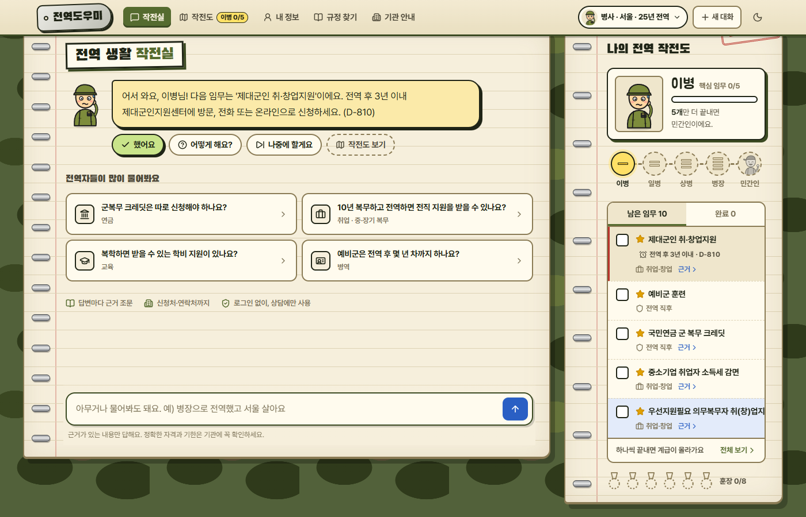
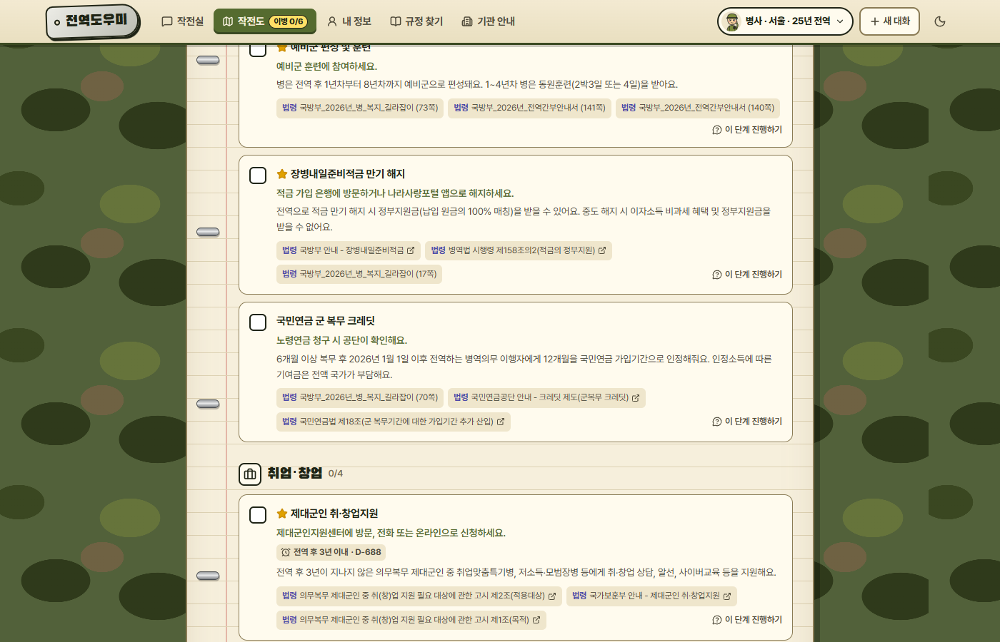

# 전역도우미 (jeonyeok_helper)

전역자가 자기 상황을 말하면 **받을 수 있는 혜택, 근거 규정, 신청처**를 한 번에 알려주는 AI 에이전트입니다.

- **규정 Q&A**: 법령, 행정규칙, 법령해석례, 지자체 조례, 국가보훈부 자료를 RAG로 검색해 근거 조문과 함께 답변
- **맞춤 혜택 찾기**: 복무 형태, 기간, 나이, 지역에 맞는 공공서비스 혜택 조회
- **기관 연계**: 소관 기관, 신청 방법, 링크, 연락처 안내
- **길잡이 대화**: 길잡이 '전역이'가 먼저 말을 걸고 복무 형태 → 지역 → 전역일을 버튼으로 하나씩 물어 로드맵을 만든 뒤,
  다음 할 일을 하나씩 권한다 ([했어요] [어떻게 해요?] [나중에]). 자료가 필요한 질문만 RAG로 찾아 답하고,
  긴 답변은 '자세히 보기'로 접어 두고 위에 "지금 이것부터" 한마디를 보여 준다
- **전역 로드맵**: 답변에서 길잡이가 제안한 할 일 중 고른 것을 담고, 끝낸 개수로 계급(이병 → 병장)이 오른다.
  단계마다 ⭐핵심 할 일을 다 끝내면 민간인(완주). 근거 자료에 신청 기한이 있으면 전역일 기준 D-day로 보여 준다
- **내 정보**: 복무·지역·학력·주거·목표·희망 직무·자격증·메모를 자세히 적어 두면 답변과 로드맵 검색에 반영

자세한 내용은 [기획서](docs/기획서.md), [개발 순서](docs/개발순서.md), [작업 기록](docs/작업기록.md)을 참고하세요.
직접 써 보는 순서는 [사용·테스트 안내](docs/사용_테스트_안내.md)에 있습니다.

## 화면

| 처음 온 사람: 전역이가 먼저 묻기 | 버튼으로 답하면 로드맵 완성 |
|---|---|
|  |  |

| "어떻게 해요?" → 한마디 + 자세히 보기 | "했어요" → 계급 오르고 다음 할 일 |
|---|---|
|  |  |

| 다시 왔을 때 (D-day) | 내 로드맵 | 다크 모드 |
|---|---|---|
|  |  |  |

| 모바일 | 할 일 카드 | 내 정보 |
|---|---|---|
|  |  |  |

<details><summary>예전 화면 (검색형 답변)</summary>

| 첫 화면 | 답변 화면 |
|---|---|
|  |  |

| 모바일 | 모바일 메뉴 | 다크 모드 |
|---|---|---|
|  |  |  |

</details>

> 예전 화면은 데모 모드입니다. 백엔드에 Gemini 키가 없으면 자동으로 데모 모드로 열려 예시 응답을 보여줍니다. `?q=질문` 주소로 들어오면 바로 질문합니다.

## 구조

```
브라우저 ─▶ Next.js (frontend) ─/api/*─▶ FastAPI (backend) ─▶ 슈퍼바이저 (Gemini, LangGraph)
                                                                ├─ 규정 에이전트     (RAG)
                                                                ├─ 혜택 에이전트     (MCP → 공공서비스 API)
                                                                └─ 기관연계 에이전트
                                                             ─▶ 근거 검증 ─▶ 답변 (SSE 스트리밍)
```

| 영역 | 기술 |
|---|---|
| 화면 | Next.js 16 (App Router), React 19, TypeScript, Tailwind CSS 4 |
| LLM | Gemini |
| 에이전트 | LangChain, LangGraph |
| 평가 | 답변 평가 41문항 + 규정 검색 골든셋 69문항 (`jeonyeok-eval`, `--retrieval`) |
| 도구 연동 | MCP |
| RAG | PostgreSQL + pgvector, HyDE, Re-ranking |
| 서버 | FastAPI (SSE), PostgreSQL (벡터 검색·피드백, SQLAlchemy 2.0 + Alembic), SQLite (대화 기록·프로필) |
| 배포 | Docker Compose, GitHub Actions |

## 폴더

```
backend/                      # Python (uv)
├─ src/jeonyeok_helper/
│  ├─ rag/                    # 법령·문서 수집과 검색
│  ├─ benefits/               # 공공서비스 API, 기관 링크, MCP 서버
│  ├─ agents/                 # LangGraph 슈퍼바이저와 워커
│  ├─ api/                    # FastAPI
│  └─ evaluation.py           # 평가
├─ tests/
└─ data/                      # 수집 법령 목록, 기관 목록, 평가 질문
frontend/                     # Next.js
├─ src/app/                   # 페이지, /api/* 프록시
├─ src/components/            # 화면 컴포넌트
└─ src/lib/                   # SSE 처리, 답변 해석, 데모 응답
docs/
docker-compose.yml
```

## 시작하기

### Docker로 한 번에

```bash
cp backend/.env.example backend/.env   # 키 입력
docker compose up --build              # http://localhost:3000
```

### 개발 모드

백엔드 ([uv](https://docs.astral.sh/uv/), Docker 필요):

```bash
docker compose up -d db    # PostgreSQL(pgvector), localhost:5432
cd backend
uv sync
cp .env.example .env
uv run jeonyeok-serve      # http://127.0.0.1:8000
```

프론트엔드 (Node 24):

```bash
cd frontend
npm install
npm run dev                # http://localhost:3000, /api/* 는 API_URL(기본 127.0.0.1:8000)로 전달
```

## 백엔드 명령

| 명령 | 설명 |
|---|---|
| `uv run jeonyeok-rag laws` | `data/laws.yaml`의 법령·행정규칙(훈령·고시) 수집 (LAW_API_OC 필요) |
| `uv run jeonyeok-rag ordinances` | `data/ordinances.yaml` 기준 지자체 조례 수집 (LAW_API_OC 필요) |
| `uv run jeonyeok-rag interpretations` | `data/interpretations.yaml` 기준 국가보훈부·국방부·병무청·법제처 법령해석례 수집 |
| `uv run jeonyeok-rag datasets` | 공공데이터 CSV(보훈 민원·구비서류, 장학금) 수집, 파일이 없으면 data.go.kr에서 내려받음 |
| `uv run jeonyeok-rag files` | `data/raw/`의 PDF·TXT·MD 수집 (HWP는 PDF로 변환, 글자 없는 PDF는 Gemini로 옮겨 적음) |
| `uv run jeonyeok-rag web` | `data/webpages.yaml`의 기관 안내 페이지(국가보훈부·국방부·국민연금·고용24) 수집 |
| `uv run jeonyeok-rag search "질문" [--region 부산]` | HyDE + Re-ranking 검색 결과 확인 (지역을 주면 그 지역 조례 포함) |
| `uv run jeonyeok-mcp` | MCP 서버 (stdio) |
| `uv run jeonyeok-chat` | 터미널에서 에이전트와 대화 |
| `uv run jeonyeok-eval` | 평가 40문항 채점, `data/eval/results/`에 보고서 |
| `uv run jeonyeok-eval --retrieval [--ablation]` | 규정 검색 골든셋(Hit@k·Recall@k·MRR), 검색 설정 비교 |

### API

| API | 설명 |
|---|---|
| `POST /chat` | `{message, thread_id?, user_id?, action?}` → SSE (`thread`, `step`, `delta`, `answer`, `guide`, `journey`, `question`, `error`, `done`). `guide`는 길잡이 한마디·버튼·할 일 제안, `action`은 버튼 동작(`done`·`later`) |
| `GET /profile/{user_id}` | 저장된 사용자 프로필 |
| `PUT /profile/{user_id}` | 내 정보 저장 (보낸 칸만 바꾸고, 빈 값은 지움) |
| `GET /journey/{user_id}` | 로드맵 할 일 목록 (단계 순) |
| `POST /journey/{user_id}/generate` | 내 정보로 할 일을 한 번에 모아 담기 → `{intro, added, items}` |
| `POST /journey/{user_id}/items` | 길잡이가 제안한 할 일 중 고른 것 담기 `{items, question}` |
| `PATCH /journey/{user_id}/items/{id}` | `{done}` 완료 체크 |
| `DELETE /journey/{user_id}/items/{id}` | 할 일 빼기 |
| `POST /feedback` | 답변 피드백 저장 `{rating: up/down, question, answer, comment?}` |
| `GET /feedback/summary` | 피드백 수 (화면 프록시로는 열지 않음) |
| `GET /health` | 상태, 에이전트 준비 여부, 키 설정 여부 |

### MCP 도구

| 도구 | 하는 일 |
|---|---|
| `search_regulations` | 법령·보훈부 자료에서 근거 조문 검색, 지역을 주면 그 지역 조례도 |
| `search_benefits` | 정부24 공공서비스(혜택)에서 전역자 혜택 조회, 지역 필터 |
| `get_benefit_detail` | 혜택의 선정기준, 구비서류, 신청방법 |
| `search_youth_policies` | 온통청년 청년정책 3,000여 건, 지역·나이·키워드 필터, 군 복무 관련 정책 우선 |
| `search_jobs` | 제대군인지원센터(브이넷) 마감 전 채용공고, 지역·키워드 필터 (키 불필요) |
| `search_veteran_jobs` | 국가보훈부 보훈관서 채용정보: 보훈특별고용·공무원 특별채용 마감 전 공고 (키 불필요) |
| `find_stores` | 병무청 나라사랑가게(예비군 훈련 이수자·현역병 할인) 지역별 목록 |
| `find_veterans_office` | 관할 지방보훈청·보훈지청 27곳 주소·전화 ([veterans_offices.yaml](backend/data/veterans_offices.yaml)) |
| `find_hospitals` | 지역별 보훈 위탁병원(국가유공자 진료비 감면) 주소·전화·지도 링크 |
| `find_institutions` | 주제별 기관 사이트·연락처 ([institutions.yaml](backend/data/institutions.yaml)) |

API 키가 없거나 호출이 실패하면 오류 대신 정부24, 온통청년 등 직접 찾아볼 수 있는 기관 링크를 돌려줍니다. Claude Desktop 같은 MCP 클라이언트에는 아래처럼 연결합니다.

```json
{
  "mcpServers": {
    "jeonyeok_helper": {
      "command": "uv",
      "args": ["--directory", "<레포 경로>/backend", "run", "jeonyeok-mcp"]
    }
  }
}
```

### 에이전트 흐름

```
start → profile(복무 정보 추출) → coach(길잡이) ─┬→ talk: 인사·진행 보고·정보 알려 주기 → 바로 짧게 답 (검색 없음)
                                                └→ supervisor ─┬→ regulation / benefit / institution → supervisor
                                                               ├→ ask_user (정보가 부족하면 되묻기)
                                                               └→ respond → verify(근거 검증) → guide(한마디·할 일 제안)
```

- 버튼은 LLM이 아니라 규칙으로 만든다: 모르는 정보가 있으면 고르는 버튼, 없으면 다음 할 일 버튼
- 다음 할 일: 안 끝낸 것 중 ⭐핵심 → 기한 빠른 것 → 단계 순 (`agents/guide.py`의 `next_item`)
- 복무 형태·지역·전역일을 다 알면 첫 로드맵을 자동으로 만들고 첫 할 일을 권한다
- 할 일의 신청 기한은 근거 자료에 그 문구가 실제로 있을 때만 남긴다 (`journey.ground_deadline`)

## 테스트

```bash
cd backend && uv run pytest && uv run ruff check .
cd frontend && npm test && npm run lint && npm run typecheck
```

## 필요한 키 (`backend/.env`)

| 키 | 발급처 | 용도 |
|---|---|---|
| `GOOGLE_API_KEY` | [Google AI Studio](https://aistudio.google.com/apikey) | Gemini |
| `LAW_API_OC` | [국가법령정보센터 Open API](https://open.law.go.kr) | 법령, 조례 수집 |
| `DATA_GO_KR_SERVICE_KEY` | [공공데이터포털](https://www.data.go.kr) | 공공서비스(혜택), 보훈 위탁병원, 나라사랑가게 |
| `YOUTHCENTER_API_KEY` | [온통청년](https://www.youthcenter.go.kr) (마이페이지 > OPEN API) | 청년정책 |

## 안내

이 서비스의 답변은 참고용입니다. 실제 자격과 신청 방법은 소관 기관에 꼭 확인하세요.
