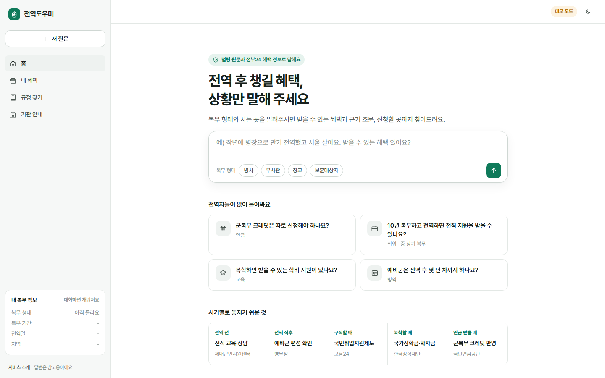
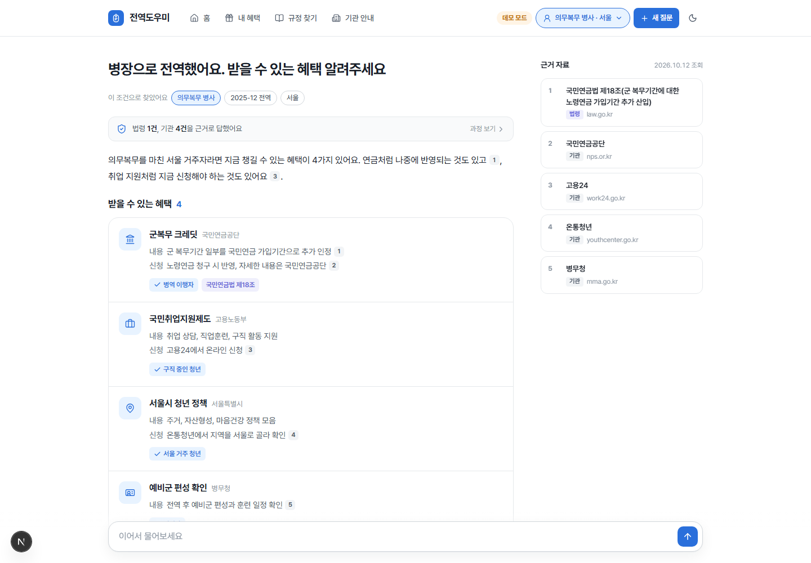
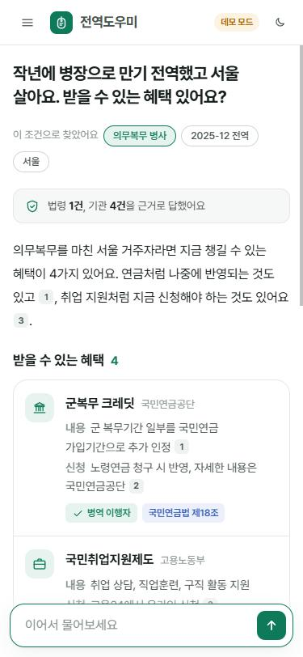
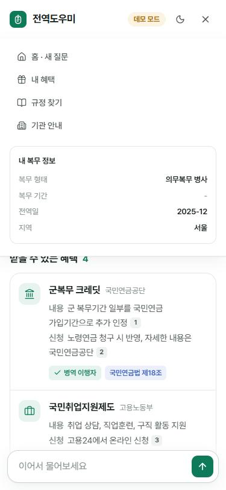
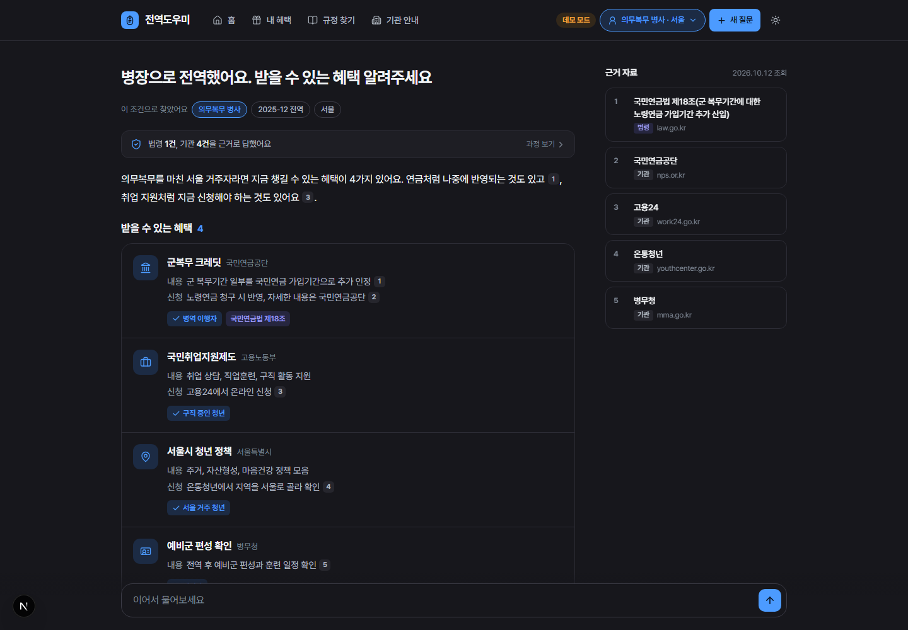

# 전역도우미 (jeonyeok_helper)

전역자가 자기 상황을 말하면 **받을 수 있는 혜택, 근거 규정, 신청처**를 한 번에 알려주는 AI 에이전트입니다.

- **규정 Q&A**: 법령, 지자체 조례, 국가보훈부 자료를 RAG로 검색해 근거 조문과 함께 답변
- **맞춤 혜택 찾기**: 복무 형태, 기간, 나이, 지역에 맞는 공공서비스 혜택 조회
- **기관 연계**: 소관 기관, 신청 방법, 링크, 연락처 안내

자세한 내용은 [기획서](docs/기획서.md)와 [개발 순서](docs/개발순서.md)를 참고하세요.

## 화면

| 첫 화면 | 답변 화면 |
|---|---|
|  |  |

| 모바일 | 모바일 메뉴 | 다크 모드 |
|---|---|---|
|  |  |  |

> 데모 모드 화면입니다. 백엔드에 Gemini 키가 없으면 자동으로 데모 모드로 열려 예시 응답을 보여줍니다. `?q=질문` 주소로 들어오면 바로 질문합니다.

## 구조

```
브라우저 ─▶ Next.js (frontend) ─/api/*─▶ FastAPI (backend) ─▶ 슈퍼바이저 (Gemini, LangGraph)
                                                                ├─ 규정 에이전트     (RAG)
                                                                ├─ 혜택 에이전트     (MCP → 공공서비스 API)
                                                                └─ 기관연계 에이전트
                                                             ─▶ 근거 검증 ─▶ 답변 (SSE 스트리밍)
```

| 영역 | 기술 |
|---|---|
| 화면 | Next.js 16 (App Router), React 19, TypeScript, Tailwind CSS 4 |
| LLM | Gemini |
| 에이전트 | LangChain, LangGraph |
| 평가 | 평가 데이터셋 30문항 (`jeonyeok-eval`) |
| 도구 연동 | MCP |
| RAG | Chroma, HyDE, Re-ranking |
| 서버 | FastAPI (SSE), SQLite (대화 기록·프로필) |
| 배포 | Docker Compose, GitHub Actions |

## 폴더

```
backend/                      # Python (uv)
├─ src/jeonyeok_helper/
│  ├─ rag/                    # 법령·문서 수집과 검색
│  ├─ benefits/               # 공공서비스 API, 기관 링크, MCP 서버
│  ├─ agents/                 # LangGraph 슈퍼바이저와 워커
│  ├─ api/                    # FastAPI
│  └─ evaluation.py           # 평가
├─ tests/
└─ data/                      # 수집 법령 목록, 기관 목록, 평가 질문
frontend/                     # Next.js
├─ src/app/                   # 페이지, /api/* 프록시
├─ src/components/            # 화면 컴포넌트
└─ src/lib/                   # SSE 처리, 답변 해석, 데모 응답
docs/
docker-compose.yml
```

## 시작하기

### Docker로 한 번에

```bash
cp backend/.env.example backend/.env   # 키 입력
docker compose up --build              # http://localhost:3000
```

### 개발 모드

백엔드 ([uv](https://docs.astral.sh/uv/) 필요):

```bash
cd backend
uv sync
cp .env.example .env
uv run jeonyeok-serve      # http://127.0.0.1:8000
```

프론트엔드 (Node 24):

```bash
cd frontend
npm install
npm run dev                # http://localhost:3000, /api/* 는 API_URL(기본 127.0.0.1:8000)로 전달
```

## 백엔드 명령

| 명령 | 설명 |
|---|---|
| `uv run jeonyeok-rag laws` | `data/laws.yaml`의 법령 수집 (LAW_API_OC 필요) |
| `uv run jeonyeok-rag files` | `data/raw/`의 PDF·TXT·MD 수집 (HWP는 PDF로 변환) |
| `uv run jeonyeok-rag search "질문"` | HyDE + Re-ranking 검색 결과 확인 |
| `uv run jeonyeok-mcp` | MCP 서버 (stdio) |
| `uv run jeonyeok-chat` | 터미널에서 에이전트와 대화 |
| `uv run jeonyeok-eval` | 평가 30문항 채점, `data/eval/results/`에 보고서 |

### API

| API | 설명 |
|---|---|
| `POST /chat` | `{message, thread_id?, user_id?}` → SSE (`thread`, `step`, `answer` / `question`, `error`, `done`) |
| `GET /profile/{user_id}` | 저장된 사용자 프로필 |
| `GET /health` | 상태, 에이전트 준비 여부, 키 설정 여부 |

### MCP 도구

| 도구 | 하는 일 |
|---|---|
| `search_regulations` | 법령·보훈부 자료에서 근거 조문 검색 |
| `search_benefits` | 정부24 공공서비스(혜택)에서 전역자 혜택 조회, 지역 필터 |
| `get_benefit_detail` | 혜택의 선정기준, 구비서류, 신청방법 |
| `find_institutions` | 주제별 기관 사이트·연락처 ([institutions.yaml](backend/data/institutions.yaml)) |

API 키가 없거나 호출이 실패하면 오류 대신 정부24, 온통청년 등 직접 찾아볼 수 있는 기관 링크를 돌려줍니다. Claude Desktop 같은 MCP 클라이언트에는 아래처럼 연결합니다.

```json
{
  "mcpServers": {
    "jeonyeok_helper": {
      "command": "uv",
      "args": ["--directory", "<레포 경로>/backend", "run", "jeonyeok-mcp"]
    }
  }
}
```

### 에이전트 흐름

```
start → profile(복무 정보 추출) → supervisor ─┬→ regulation / benefit / institution → supervisor
                                              ├→ ask_user (정보가 부족하면 되묻기)
                                              └→ respond(답변 초안) → verify(근거 검증)
```

## 테스트

```bash
cd backend && uv run pytest && uv run ruff check .
cd frontend && npm test && npm run lint && npm run typecheck
```

## 필요한 키 (`backend/.env`)

| 키 | 발급처 | 용도 |
|---|---|---|
| `GOOGLE_API_KEY` | [Google AI Studio](https://aistudio.google.com/apikey) | Gemini |
| `LAW_API_OC` | [국가법령정보센터 Open API](https://open.law.go.kr) | 법령, 조례 수집 |
| `DATA_GO_KR_SERVICE_KEY` | [공공데이터포털](https://www.data.go.kr) | 공공서비스(혜택) 정보 |

## 안내

이 서비스의 답변은 참고용입니다. 실제 자격과 신청 방법은 소관 기관에 꼭 확인하세요.
