# 전역도우미

> 전역한 사람이 "나는 뭘 받을 수 있지?"라고 물으면 **받을 수 있는 혜택, 그 법적 근거, 신청할 곳**을 찾아 주고,
> 할 일 목록(작전도)과 서류 준비·기한 알림까지 이어 주는 AI 에이전트입니다. 로그인 없이 누구나 씁니다.

| 답변 평가 | 검색 골든셋 | RAGAS 근거 충실도 | 검색 자료 |
|:---:|:---:|:---:|:---:|
| **202 / 205** 문항 통과 | **Hit@6 98%** (84문항) · 처음 보는 문항 85~92% | **0.879** (179문항, 채점이 흔들림) | **10,143** 조각 (법령·조례·안내서, 7일마다 자동 갱신) |

## 왜 만들었나

**전역자들은 자기가 받을 수 있는 혜택을 잘 모릅니다.** 찾아보려 해도 제대로 아는 실무자가 드물어, 결국 본인이 직접 찾아야 합니다.

저는 병사와 간부로 총 8년 반을 복무하고 전역했습니다. 전역을 앞두고 무엇을 신청해야 하는지 알려 주는 곳이 없어 애를 먹었습니다.
혜택은 법령(제대군인지원법·국민연금법·병역법…), 보훈부·국방부 안내서, 지자체 조례, 공공기관 누리집에 흩어져 있고,
병사·단기 간부·중장기 복무·보훈대상자인지, 어디 사는지, 언제 전역하는지에 따라 받을 수 있는 것이 달랐습니다.
그리고 알게 되더라도 **기한을 놓치면** 받을 수 없었습니다(전직지원금은 전역 후 6개월).

그래서 **흩어진 자료를 모아 근거(조문)와 함께 답하고, 할 일·서류·기한 알림까지 이어 주는 에이전트**를 만들었습니다.

## 할 수 있는 것

| 기능 | 하는 일 |
|---|---|
| **물어보면 근거와 함께 답** | 법령·조례·안내서·실시간 혜택 API를 찾아 답하고, 답변의 [1], [2]를 누르면 **원문(조문·쪽)과 시행일**을 바로 보여 줌 |
| **길잡이와 작전도** | 복무 형태·지역·전역일을 버튼 몇 번으로 받아 시기별 할 일(작전도)을 만들고, "했어요"를 누르면 계급이 오르며 다음 할 일을 권함 |
| **신청 서류 도우미** | "전직지원금 신청할래요" → 챙길 서류 체크리스트, 내 정보로 채운 신청 내용, 관할 보훈청, 마감일 (주요 제도 5개) |
| **기한 놓치지 않기** | 마감일을 캘린더(.ics)에 넣거나, 브라우저 알림(마감 30·7·1일 전)을 켬. 휴대폰 홈 화면에 앱처럼 설치 |
| **로그인 없이 기록 지키기** | 내 기록을 파일로 저장·불러오기, 다른 기기에서 이어 하는 코드와 QR, 브라우저 사본 |

## 화면

| 묻는 동안 찾은 자료를 먼저 보여 줌 | 답변의 [n] → 근거 원문 |
|---|---|
| 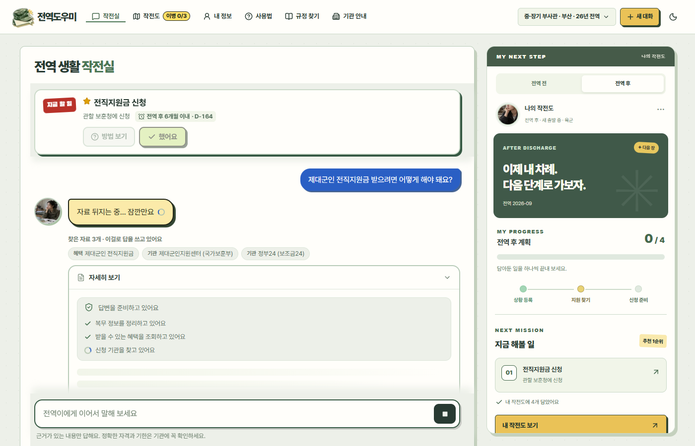 | 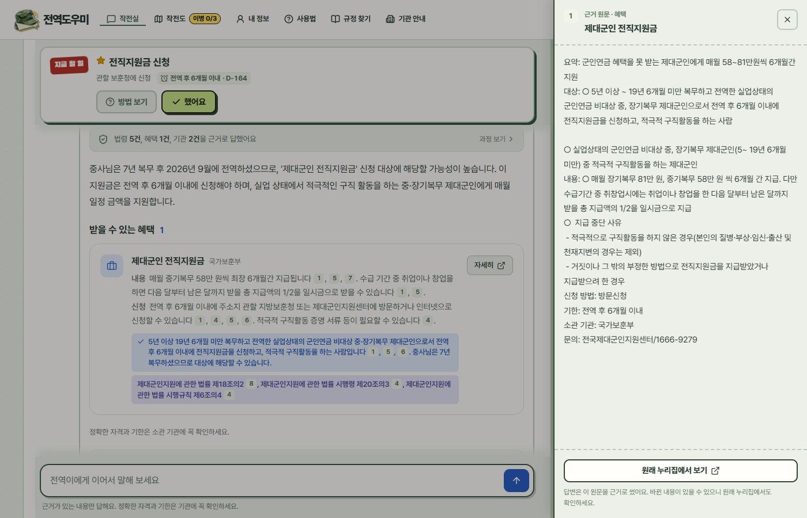 |

| 신청 서류 도우미 | 작전도: 캘린더·알림·서류 도우미 |
|---|---|
| 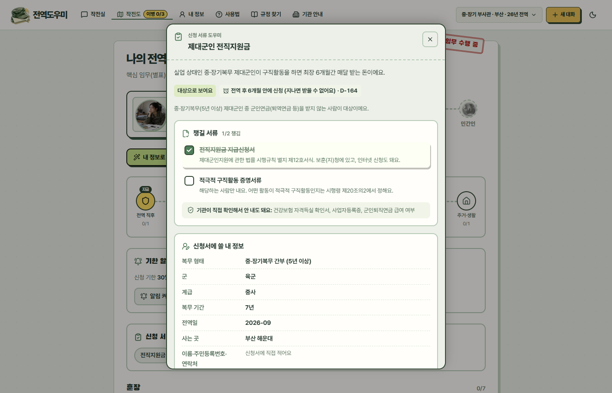 | 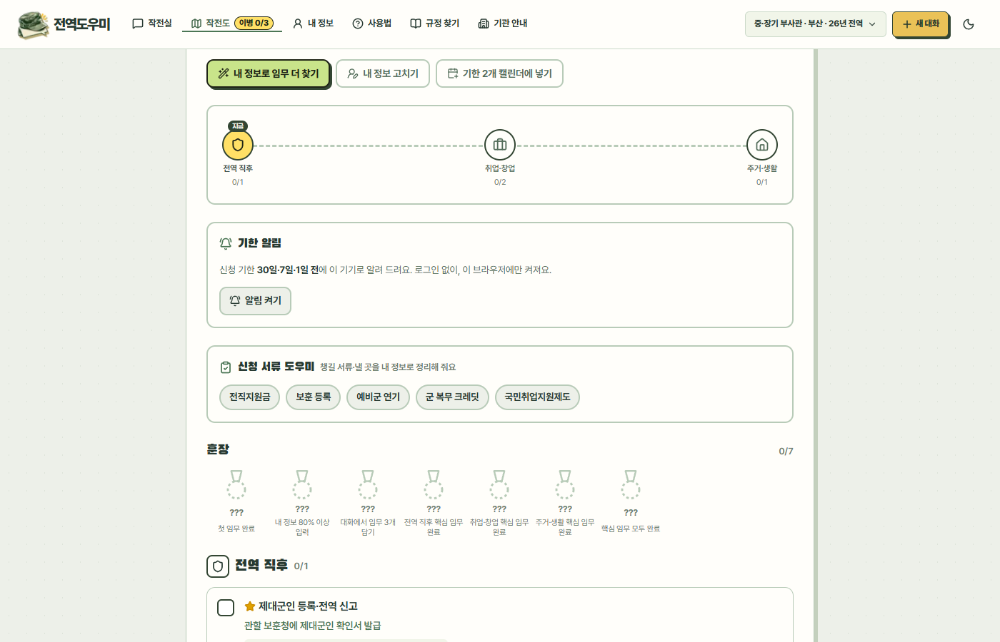 |

<details><summary>화면 더 보기 (첫 방문, 길잡이, 작전도, 운영 대시보드, 다크 모드, 모바일)</summary>

| 처음 온 사람: 묻거나 복무 형태를 고르면 | 버튼 몇 번으로 작전도 완성 |
|---|---|
| 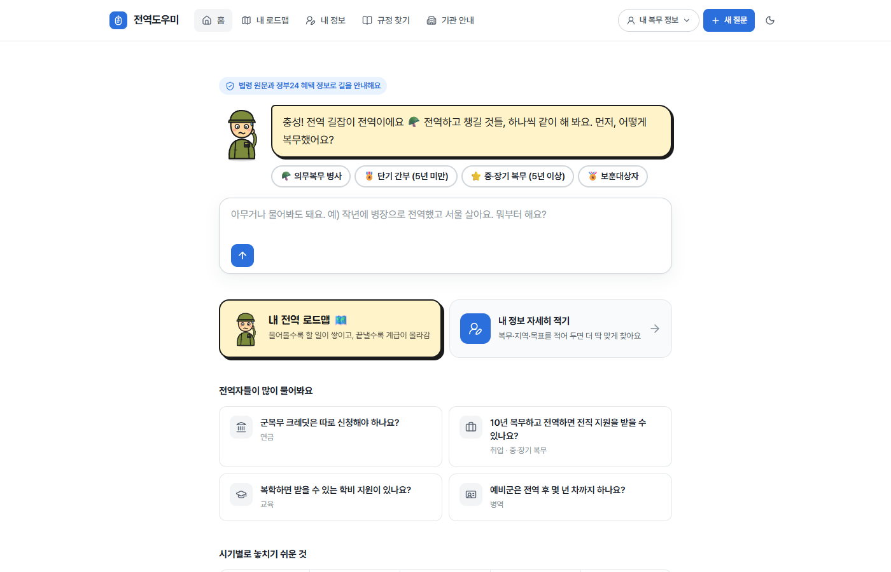 | 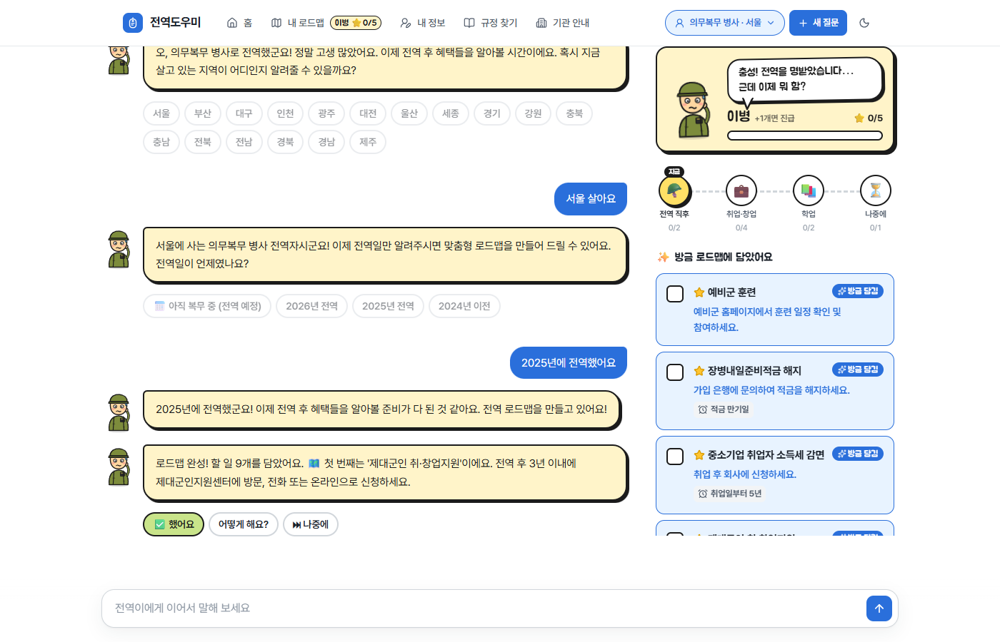 |

| "어떻게 해요?" → 근거와 함께 답변 | "했어요" → 계급이 오르고 다음 임무 |
|---|---|
|  | 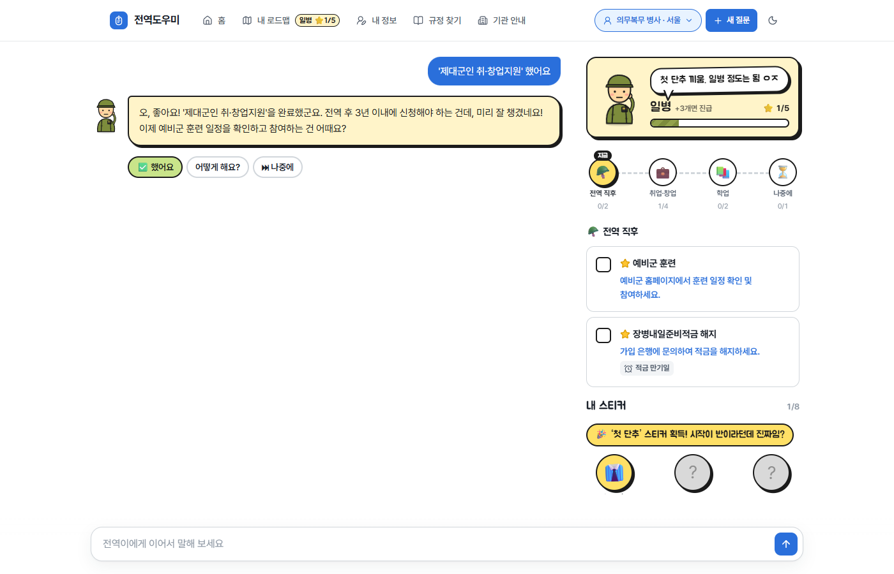 |

| 나의 전역 작전도 | 운영 대시보드 (관리자) |
|---|---|
|  | 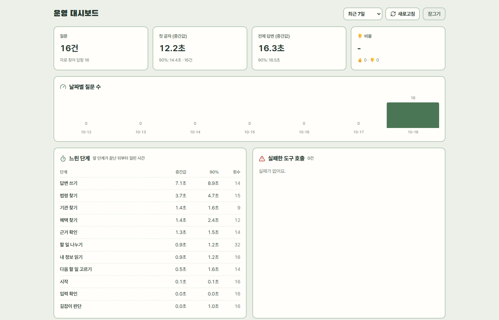 |

| 내 정보 | 사용법 | 다크 모드 |
|---|---|---|
|  |  |  |

| 모바일 첫 화면 | 모바일 대화 |
|---|---|
|  | 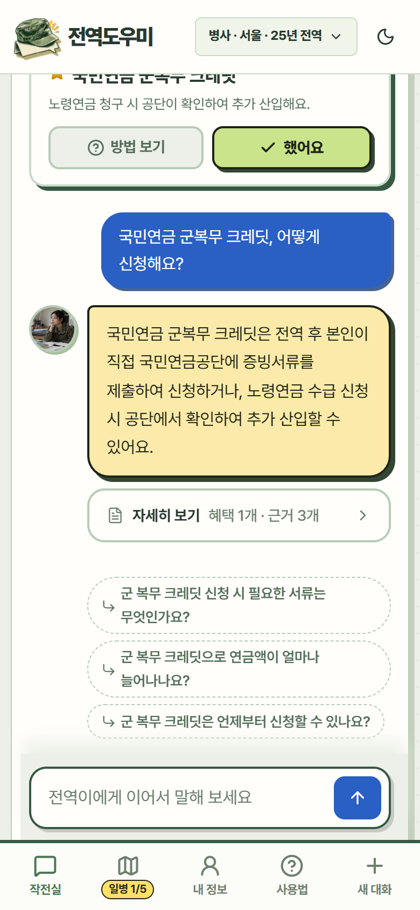 |

</details>

## 구조

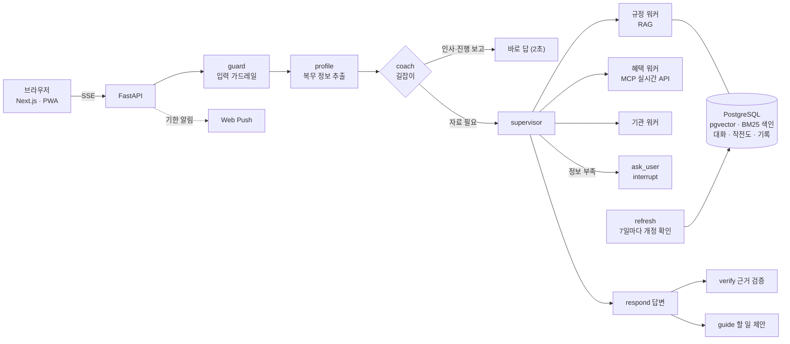

LangGraph 슈퍼바이저가 질문에 맞는 워커를 고르고(규정·혜택은 동시에 실행), 답변은 워커가 가져온 **도구 원문만** 근거로 씁니다.
모든 저장(벡터, 키워드 색인, 대화 기록, 프로필, API 응답, 작전도, 알림 구독, 운영 기록)은 PostgreSQL 하나에 둡니다.

## 기술을 어떻게 썼고, 무엇이 나아졌나

### 1. 하이브리드 검색 (pgvector + BM25 + HyDE + 재정렬)

| | |
|---|---|
| **문제** | "군대 갔다온 거 연금에 쳐주나요" 같은 구어체는 "가입기간 추가 산입" 같은 조문 문장과 벡터 거리가 멀고, "공무상요양비"·"제25조"처럼 정확한 용어는 벡터 검색이 놓친다 |
| **적용** | ① 벡터 검색(gemini-embedding-001, pgvector) ② **HyDE**: 모델이 법령 문체의 가상 조문을 써서 한 번 더 검색 ③ **BM25**: Kiwi 형태소 분석(조사 제거) 키워드 검색 → 셋을 **RRF**로 합치고 ④ LLM **재정렬** 후 같은 문서는 2개까지 |
| **결과** | 골든셋 84문항 Hit@6 100%(당시 채점 기준), **Recall@6 99% → 100%** (BM25 추가). BM25 없이 놓치던 "휴가 중 사고, 민간병원" 질문의 공무상요양비 조문을 찾음 |
| **그래서 지금은** | 키워드 가중치를 0.3~1.0으로 비교해 근거를 하나도 놓치지 않은 1.0을 씀. BM25 색인(28MB)은 Postgres에 저장해 DB 지문(md5)이 같으면 다시 만들지 않음 |

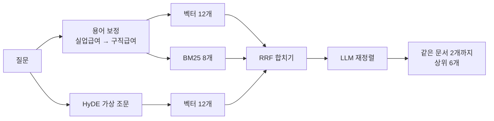

- 조례는 사용자 지역 것만 찾습니다(지자체마다 비슷한 조례가 수백 개라 섞이면 법령이 밀려남).
- 600쪽짜리 안내서가 상위를 다 차지하던 문제를 "같은 문서 2개까지"로 막았습니다(제한 전 평가 24/30까지 하락).

### 2. 평가: 키워드 채점 + 검색 골든셋 + RAGAS

| | |
|---|---|
| **문제** | "좋아 보이는데"로는 프롬프트·자료를 바꿀 때 무엇이 망가졌는지 알 수 없다 |
| **적용** | ① 답변 평가 205문항(근거 출처·핵심 내용·되묻기·도구·프로필 추출·나오면 안 되는 말 채점. 전제가 틀린 질문 등 어려운 질문 34개, 가드레일 8개 포함) ② 검색 골든셋 84문항(Hit·Recall·MRR) ③ **RAGAS**: 근거 충실도·답변 관련성·자료 관련성 |
| **결과** | RAGAS가 키워드 채점이 놓친 문제를 찾음: 나라사랑가게 목록에 원문에 없는 "대상·내용"을 지어 넣음(근거 충실도 **0.09 → 0.97**), 위탁병원 목록에서 얼버무림(답변 관련성 **0 → 0.97**) |
| **그래서 지금은** | 기능을 바꾸면 세 평가를 다시 돌림. 평가를 63 → 205문항으로 늘리자 지어낸 전역일, 자격 질문을 검색 없이 답하는 문제가 새로 드러나 고침. 기능 9개를 더한 뒤 다시 돌린 결과 **202/205**, RAGAS 근거 충실도 0.879·답변 관련성 0.85·자료 관련성 0.947 |

- 정답은 검색 결과를 베끼지 않고 조문·쪽 내용으로 정했고, 금액·기한처럼 바뀌는 사실은 채점 기준에 넣지 않았습니다.
- 회귀를 실제로 잡았습니다: 프로필 추출 항목을 늘리자 41/41 → 37/41로 떨어져 되돌렸고, 자료를 늘리자 24/30까지 떨어져 원인(큰 문서가 법령을 밀어냄)을 고쳤습니다.

### 3. 환각 줄이기: 원문 기준 답변 · 근거 검증 · 원문 보기

| | |
|---|---|
| **문제** | 모델이 그럴듯한 금액·기한·자격·서류를 지어내고, 사용자는 답이 맞는지 확인할 방법이 없다 |
| **적용** | 답변 모델에는 **도구 원문**만 근거로 줌 → **verify 노드**가 초안 문장마다 원문에 있는지 대조해 고칠 문장만 돌려받음 → 기한은 출처에 그 문구가 있을 때만 남김. 출처마다 원문 발췌(최대 1,500자)와 시행일을 붙여 **[n]을 누르면 원문 패널**로 보여 줌. 신청 서류 목록은 **LLM이 만들지 않고** 민원 구비서류·법령·훈령 근거 그대로 데이터로 둠 |
| **결과** | 답변의 모든 출처 번호가 원문으로 열림(실제 답변 17번 확인). 서류 목록은 근거 자료에 적힌 것만 나옴 |

### 4. LangGraph 에이전트: 검색기가 아니라 길잡이

| | |
|---|---|
| **문제** | 사용자는 "무슨 혜택이 있는지"보다 "그래서 나는 뭘 해야 하지?"가 궁금하다. 인사에도 검색을 돌리면 느리다 |
| **적용** | 맨 앞에 **coach 노드**: 인사·진행 보고는 검색 없이 답하고, 자료가 필요한 질문만 supervisor로. 버튼(복무 형태 고르기, 했어요·어떻게 해요?, 서류 챙기기)은 **LLM이 아니라 규칙**으로 만들어 매번 같게 |
| **결과** | 인사·진행 보고는 2~3초. 버튼 두세 번으로 작전도 완성, "신청할래요"라고 하면 서류 도우미 버튼이 붙음 |

### 5. Human-in-the-loop (interrupt)

| | |
|---|---|
| **문제** | 정보가 모자라 되물으면 그래프가 끝나고, 사용자가 답하면 처음부터(프로필 → 라우팅 → 워커) 다시 돌았다 |
| **적용** | `ask_user`가 `interrupt()`로 멈추고, 사용자의 답을 API가 `Command(resume=답)`으로 넘겨 **멈춘 자리에서 이어 감**. 대화 상태는 Postgres 체크포인터에 남음 |
| **결과** | 되묻기 전에 찾은 자료를 다시 검색하지 않음(테스트로 워커 호출 1회 확인) |

### 6. MCP 실시간 도구 + 응답 저장

| | |
|---|---|
| **문제** | 혜택·채용·병원 목록은 계속 바뀌어 임베딩해 둘 수 없고, 매번 받으면 느리다 |
| **적용** | 정부24·온통청년·제대군인지원센터 채용·보훈 채용·보훈 위탁병원·나라사랑가게·관할 보훈청을 **MCP 서버 도구 10개**로 묶음. 응답은 메모리 + Postgres에 유효 시간(1~24시간) 동안 저장 |
| **결과** | 서버를 다시 켠 뒤 나라사랑가게 2,625건 **4.3초 → 0.2초**, 온통청년 3,264건 **4.2초 → 0.2초**. API가 실패하면 직접 찾아볼 기관 링크로 대체 |

### 7. 자료 자동 갱신

| | |
|---|---|
| **문제** | 법령이 개정돼도 다시 수집하기 전까지 예전 조문으로 답한다. 매번 전부 다시 임베딩하면 비용이 크다 |
| **적용** | 국가법령정보센터의 **개정 일련번호**를 저장해 두고 7일마다 목록 검색으로 비교해 **바뀐 법령·행정규칙·조례만** 다시 임베딩, 개정으로 없어진 조문·폐지 조례는 지움(한꺼번에 많이 사라지면 검색 오류로 보고 건너뜀). 끝나면 BM25 저장 + 검색 골든셋을 자동 실행해 점수를 DB에 기록하고 떨어지면 표시. 서버는 10분마다 색인 지문을 보고 새 색인으로 바꿔 끼움 |
| **결과** | 첫 실행에서 **실제 개정 9건**(4일 전 개정된 예비군 교육훈련 훈령, 시행 예정본이 들어가 있던 고용보험법 등)을 찾아 276개 조문 반영, Recall 유지. 나머지 537개는 번호만 기록해 다시 임베딩하지 않음. 답변에는 "2026.10.18 확인 자료"처럼 기준일 표시 |

### 8. 운영 대시보드로 병목 찾기 → 첫 화면 반응

| | |
|---|---|
| **문제** | 자료 질문은 첫 글자까지 13초 넘게 걸리는데, 어디가 느린지 감으로만 알았다 |
| **적용** | 질문마다 단계별로 끝난 시각·첫 글자·실패한 도구 호출을 기록(질문은 개인정보를 가려 앞부분만)하고 **관리자 화면**(👎 피드백·느린 단계·실패)으로 모아 봄. 병목: 답변 쓰기 7.3초, 법령 찾기 3.7초, 필요 없는 프로필 추출 1초 → 복무 정보 단서가 없는 질문은 프로필 추출을 건너뛰고(평가에서 프로필을 기대하는 66문항은 영향 없음), 워커가 찾은 자료를 답변 전에 먼저 보냄 |
| **결과** | 첫 화면에 내용이 보이기까지 약 13초 → **2.6~3.9초**, 첫 글자 중간값 13.1초 → 11.6초 (같은 6문항) |

그 전에 한 속도 개선: 규정·혜택 워커 동시 실행, 근거 검증은 고칠 문장만, 생각 예산 비교(27.1초 → 21.4초, 같은 정답률), 같은 질문 1시간 저장.

### 9. 계정 없는 서비스: 기록 지키기와 기한 알림

| | |
|---|---|
| **문제** | 누구나 바로 쓰게 하려고 로그인을 두지 않았다. 그러면 브라우저를 바꾸면 기록이 사라지고, 기한을 알려 줄 이메일도 없다 |
| **적용** | 기록: 파일 저장·불러오기, 짧은 **이어 하기 코드**(헷갈리는 글자를 뺀 8자, 약 8,500억 가지)와 QR, 브라우저 사본(서버 기록이 사라지면 복구). 기한: **.ics**(RFC 5545, 마감 7·1일 전 알림), **Web Push**(VAPID, 마감 30·7·1일 전, 밤에는 보내지 않고 놓친 알림은 하나만), **PWA**(홈 화면 설치, 아이폰 알림) |
| **결과** | 새 브라우저에서 파일·코드·QR로 완료 표시까지 이어짐을 확인. 캘린더 파일은 iCalendar 파서로, 웹 푸시는 가짜 브라우저 구독에 실제로 암호화·서명해 보내고 받는 쪽에서 복호화까지 테스트 |

### 10. 안정성과 보안

| 기술 | 적용 | 결과 |
|---|---|---|
| **가드레일** | 프롬프트 인젝션은 검색 전에 규칙으로 차단, 주민번호·카드번호·군번은 LLM과 대화 기록에 닿기 전에 가림 | 대화 기록(Postgres)에 원래 번호 0건. LLM 판단을 쓰지 않아 질문마다 1~2초 절약 |
| **TimeoutPolicy · RetryPolicy · error_handler** | 답변 노드 90초 제한, 끊긴 연결만 재시도, 실패 시 안내 문구로 종료. 워커는 노드 안에서 45초 제한 | 화면이 계속 도는 일 방지 (병렬 노드에서 error_handler가 동작하지 않는 것을 확인함) |
| **횟수 제한** | 채팅은 사용자별, 이어 하기 코드·관리자 열쇠는 접속 주소별 + **모두 합친 상한** | 중계 서버(Next) 뒤에서 모든 사용자를 한 사람으로 세던 문제와, 주소 머리글을 위조해 제한을 피하는 경우를 함께 막음 |
| **열린 중계 막기** | Next `/api/*`는 허용한 경로만, 머리글도 필요한 것만 넘김. 알림 주소는 알려진 푸시 서비스만 | 서버가 임의 주소로 요청을 보내지 않음 |
| **Postgres 체크포인터 · trim_messages** | 대화 기록·프로필을 Postgres로, LLM에는 최근 약 4,000토큰만 | 대화가 길어져도 속도·비용 일정 |

## 개발·테스트에 든 모델 비용

평가를 수백 번 돌리면 비용이 얼마나 드는지 직접 쟀습니다(2026-10-27).
평가가 문항마다 그래프 단계별로 모델 호출 수·토큰·시간·비용을 기록하게 만들고(`usage.py`), 205문항을 한 번 돌린 값입니다.

**질문 하나에 드는 것** (gemini-2.5-flash, 205문항 평균)

| 단계 | 호출 | 입력 토큰 | 출력 토큰 | 모델 시간 | 비용 |
|---|---|---|---|---|---|
| respond (답변 작성, 생각 1024) | 0.86 | 5,368 | 1,180 (생각 725) | 6.0초 | $0.0046 |
| verify (근거 검증) | 0.86 | 3,869 | 187 | 1.7초 | $0.0016 |
| 규정 검색 안의 HyDE·재정렬 | 0.79 | 약 4,100 | 약 140 | | 약 $0.0016 |
| guide (말풍선·할 일 제안) | 0.86 | 1,442 | 182 | 1.6초 | $0.0009 |
| 워커 (도구 고르기) | 1.72 | 1,713 | 61 | 1.8초 | $0.0007 |
| supervisor·coach·profile | 2.48 | 1,496 | 54 | 2.5초 | $0.0005 |
| **합계** | **약 7.6** | **약 18,000** | **약 1,800** | 응답 14.5초 | **약 $0.010 (약 14원)** |

- 단가는 100만 토큰당 입력 $0.30, 출력 $2.50(생각 토큰 포함)입니다.
- 위 표는 재정렬 후보 12개일 때 값입니다. 후보를 30개로 바꾼 뒤 205문항 재측정: 응답 평균 **15.0초**(검색 3.6 → 3.9초), 추적되는 비용 $0.0083 → $0.0096, 검색 안의 재정렬 입력이 두 배라 합계는 약 $0.011(약 15원)입니다.
- 위 시간은 답이 끝까지 나온 시간입니다. 화면에서는 찾은 자료가 약 3초에, 답 첫 글자가 약 11초에 보입니다.
- **비용의 절반이 답변 작성**이고, 그중 절반 이상이 생각 토큰입니다.
- **입력의 대부분은 검색해 온 원문**을 답변(5,400)과 근거 검증(3,900)에 두 번 넣는 데서 나옵니다. 그래서 줄일 곳은 짧은 판단 단계의 모델 단가가 아니라 원문을 몇 번, 얼마나 넣는가입니다. 라우팅·판단 단계 셋을 합쳐도 비용의 5%입니다.
- 인사 같은 대화는 모델을 2~3번만 불러 약 1원, 가드레일에 걸린 질문은 모델을 부르지 않아 0원입니다.
- 규정 검색 도구는 MCP 서버 안에서 따로 돌아 단계별 기록에 잡히지 않아서, 검색만 따로 10번 재서 더했습니다.

**지금까지 쓴 것** (2026-10-10 ~ 10-27, 추정)

| 무엇 | 실행 | 추정 비용 |
|---|---|---|
| 답변 평가 | 63번 실행, 2,289문항 | 약 $23 |
| RAGAS 채점 | 10번, 약 720문항 (문항당 채점 호출 5~7번, 원문 약 3,300토큰을 여러 번 넣음) | 약 $8~18 |
| 검색 골든셋 | 17번, 약 2,000번 검색 | 약 $3 |
| 단계별 모델 교체·생각 예산 실험 (아래 '평가를 믿어도 되나') | 60문항 × 6조건 + 205문항 1번 | 약 $4 |
| 자료 임베딩 | 10,145조각(약 270만 토큰) × 여러 번 다시 만듦 | 약 $1~2 |
| 글자 없는 PDF 옮겨 적기, 화면 캡처·직접 테스트 | | 약 $3~6 |
| **합계** | | **약 $40~55 (6~8만 원)** |

- 평가 한 번(205문항)은 약 $2(약 3천 원), RAGAS까지 붙이면 약 $4~6입니다. 그래서 프롬프트를 바꿀 때마다 전체를 돌리지 않고, 바뀐 유형의 문항만 먼저 돌린 뒤 마지막에 전체를 돌렸습니다.
- 앞쪽 실행은 문항·단계가 지금과 달라서 지금 단가를 곱한 추정치입니다. 실제 청구액은 Google AI Studio 사용량 화면이 기준입니다.

## 평가를 믿어도 되나, 모델을 낮추면 어떻게 되나 (2026-10-27)

"202/205"가 높아 보여서, 이 점수를 얼마나 믿을 수 있는지와 더 싼 모델로 바꿀 수 있는지를 실험했습니다. 세 개의 Claude 세션이 각자 의견을 낸 토론은 [다음 방향 토론](docs/다음_방향_토론.md)에 있고, 거기서 나온 결론은 "모델을 바꾸기 전에 측정이 믿을 만한지부터 확인"이었습니다.

**1. 검색 점수는 개발 중에 본 문항에 맞춰져 있었다**

개발 중에 본 문항이 아닌, 정답을 법령 원문으로 따로 정한 새 문항으로 다시 쟀습니다(문항은 기존 문항을 보지 않은 별도 에이전트가 작성).

| 문항 | 문항 수 | Hit@6 | 정답 순위(MRR) |
|---|---|---|---|
| 기존 골든셋 (개발 중에 본 것) | 84 | 98% | 0.87 |
| 처음 보는 문항 1 | 25 | 92% | 0.70 |
| 처음 보는 문항 2 (고치는 데 쓰지 않음) | 20 | **85%** | **0.55** |

- 정답을 찾기는 하지만 순위가 낮습니다. 약한 곳은 보훈·의료와 교육(공상 국가유공자 자녀 등록금 면제, 군에서 병원비를 대 주는지 등)입니다.
- 채점의 허점도 찾았습니다. 정답이 "예비군법 제10조"일 때 "제10조의2"(다른 조문)만 찾아와도 맞은 것으로 쳤습니다. 다른 조문은 다르게 보도록 고쳤고, 그러자 기존 84문항이 100%에서 96%로 내려갔습니다.
- **재정렬 후보 수를 12 → 30개로** 늘렸습니다(5가지 설정을 3개 문항 세트로 비교, 두 번 반복). 처음 보는 45문항에서 정답을 찾는 비율이 87~89% → 93~96%로 올랐고 기존 문항은 그대로입니다. 재정렬에 넣는 글이 2배가 되어 검색 한 번의 입력이 5,200 → 10,900토큰, 질문당 약 $0.0013(16%) 늘어납니다. 205문항 답변 평가는 202 → 201로 오차 범위입니다. 순위(MRR)는 0.64 → 0.66으로 거의 안 올랐고, 순위를 잘 매기는 건 아직 숙제입니다.
- **재정렬 지시문에 점수 기준을 구체적으로** 적었습니다(10점=묻는 조건·금액·절차가 적힌 조문, 6~8점=같은 제도지만 핵심 조건 없음, 3점 이하=이름만 비슷한 제도, 질문 속 상황에 맞는 문서 우대, 같은 내용이면 법령 조문 우선). 처음 보는 문항 45개에서 순위(MRR) 0.64 → 0.77, 보훈·의료·교육 위주로 새로 만든 30문항(정답 찾음 87% → 97%, MRR 0.63 → 0.78)에서도 올랐습니다. 키워드 검색 비중을 1.0 → 0.5로 낮춘 것은 순위가 같거나 약간 나아서 함께 적용했습니다. 205문항 답변 평가 202/205, 응답 14.4초, 질문당 추적 비용 $0.0086으로 시간·비용은 늘지 않았습니다. (30문항은 지시문을 고르는 데도 쓰였으므로, 새 문항이 더 쌓이면 다시 잽니다.)
- 재정렬 모델에 생각을 켜는 것은 순위가 오히려 나빠지고(MRR 0.64 → 0.57) 시간이 2배(3.6 → 8.0초)라 버렸습니다.
- 키워드 검색(BM25)은 새 문항에서 효과가 불분명합니다. 45문항으로 보면 있는 쪽이 오히려 약간 낮은데(87% vs 89%), 1~2문제 차이라 노이즈일 수 있어 빼지 않았습니다. BM25는 한국어 형태소 분석기(Kiwi)가 메모리 약 500MB를 쓰는 부분이라, 문항이 더 쌓이면 다시 확인할 대상입니다.
- 일상 용어 사전(국취제, 청약, 명예전역 등 11개)을 넣으니 기존 문항은 96% → 98%로 올랐지만, 처음 보는 문항 1은 거의 그대로였습니다. 사전만으로는 부족했고, 위의 재정렬 후보 수가 더 큰 효과였습니다.

**2. 채점 모델: 후하게 주는 게 아니라 흔들린다**

같은 30문항을 답변 모델과 같은 flash, 그리고 gemini-2.5-pro로 각각 RAGAS 채점했습니다.

| | flash 채점 | pro 채점 |
|---|---|---|
| 근거 충실도 | 0.882 | 0.905 |
| 답변 관련성 | 0.836 | 0.894 |

- 자기 채점이라 flash가 후할 것이라는 예상과 달리 오히려 짰습니다. 대신 같은 답에 극단적으로 다른 점수가 나오는 문항이 있었습니다(h34: flash 0.00, pro 0.91).
- 그래서 RAGAS 숫자는 "flash 채점 기준이고 일부 문항에서 크게 흔들림"으로 읽어야 합니다. 사람이 직접 채점해 비교하는 도구(채점 화면, 비교 보고서)는 만들어 두었고 사람 채점은 아직 하지 않았습니다.

**3. 단계별로 더 싼 모델(flash-lite)로 바꿔 보기**

단계 하나만 flash-lite로 바꾸고 60문항을 돌려, 점수가 아니라 **기존과 같은 판단을 내렸는지**로 비교했습니다. 점수는 둔해서 모델이 바뀌어도 안 움직일 수 있기 때문입니다. 같은 설정을 두 번 돌린 값을 잡음 수준으로 잡았습니다.

| lite로 바꾼 단계 | 라우팅 일치 | 프로필 일치 | 전부 통과 | 평균 시간 | 문항당 비용 |
|---|---|---|---|---|---|
| 기준 (같은 설정 재실행) | 93% | 97% | 57/60 | 16.6초 | $0.0089 |
| 라우팅 | **60%** | 97% | 56/60 | 16.2초 | $0.0096 |
| 프로필 추출 | 88% | **87%** | 58/60 | 15.2초 | $0.0088 |
| coach (말로 답할지 판단) | 93% | 95% | 58/60 | 15.5초 | $0.0091 |
| 말풍선(guide) | 92% | 97% | 57/60 | 18.5초 | $0.0081 |

- 라우팅은 판단이 40% 달라지고, 프로필 추출은 내 정보를 읽는 결과가 13% 달라집니다. 이후 모든 답의 기준이 되는 단계라서 **flash를 유지**합니다.
- coach와 말풍선은 판단이 거의 같지만, 이득이 질문당 시간 1초 또는 비용 0.1원 수준이라 적용하지 않았습니다. 복잡도를 늘릴 만큼이 아닙니다.
- 단계별 비용을 쪼개 보니 이유가 보입니다. 비용의 절반이 답변 작성이고, 판단 단계 셋을 합쳐도 5%입니다. 모델을 낮춰서 줄일 수 있는 건 이 5%뿐입니다.

**4. 답변 모델의 생각 예산을 1024 → 512로**

비용의 절반이 답변 작성이고 그 절반이 생각 토큰이라서, 가장 큰 후보였습니다.

| | 60문항 | 205문항 |
|---|---|---|
| 전부 통과 | 57 → 57 | **202 → 199** |
| 평균 시간 | 16.6 → 13.9초 | 14.5 → 13.6초 |
| 문항당 비용 | $0.0089 → $0.0080 | $0.0083 → $0.0075 |

- 60문항에서는 같은 점수로 16% 빨라져 좋아 보였지만, 205문항으로 늘리니 통과가 3개 줄었습니다("병장인데 군인연금 받으려면?", "전직지원금 서류 뭐 필요해요?" 등 답에 들어가야 할 핵심 내용이 빠진 문항). 시간 이득은 6%로 줄었습니다.
- **1024를 유지**합니다. 60문항만 보고 적용했다면 품질이 떨어진 걸 모를 뻔했습니다.

## 만들면서 실패한 것과 방향을 바꾼 결정

코드는 AI 코딩 도구(Claude Code)와 함께 짰습니다. 저는 방향을 정하고, 직접 써 보며 실패를 찾고, 결과를 평가로 확인하는 역할을 했습니다.
아래는 실패한 것 → 제가 내린 지시 → 바뀐 것을 순서대로 적은 것입니다. 자세한 기록은 [작업 기록](docs/작업기록.md)에 있습니다.

| 실패·문제 | 제가 내린 지시 | 바뀐 것 | 결과 |
|---|---|---|---|
| 처음 만든 것은 질문하면 답을 길게 뽑는 RAG 챗봇이었는데, 써 보니 "그래서 나는 뭘 해야 하지?"가 남음 | "RAG도 중요한데, 자연어로 대화하며 **길을 안내하는 게 가장 중요**하다" | 그래프 맨 앞에 길잡이(coach) 노드, 규칙으로 만드는 버튼, 작전도·계급·D-day | 인사·진행 보고는 검색 없이 1~2초, 검색 답 뒤에는 다음 할 일 제안 |
| 프롬프트나 자료를 바꿀 때마다 "좋아진 것 같다"로만 판단함 | "LangSmith 대신 **평가 데이터셋을 만들어 채점**하자" | 답변 평가 30 → 63 → 205문항, 검색 골든셋 84문항, 이후 RAGAS | 자료를 늘렸더니 30/30 → 24/30, 프로필 항목을 늘렸더니 41/41 → 37/41로 떨어진 회귀를 숫자로 잡고 되돌림 |
| 수업에서 배운 기술(RAGAS·BM25 등)이 아직 안 들어가 있음 | "**수업 자료와 비교해 안 쓴 기술을 넣고**, 넣은 뒤 평가로 확인하자" | BM25 + RRF, RAGAS 3지표, interrupt 등 | 키워드 채점이 놓친 환각(나라사랑가게 목록에 대상·내용을 지어 넣음)을 RAGAS가 찾음: 근거 충실도 0.09 → 0.97 |
| 직접 써 보니 글자 겹침, 전국 채용 공고 누락, 장교·부사관 구분 없음, 끝나지 않는 질문 등 9가지 | 직접 테스트한 문제를 **'왜 안돼' 문서로 모아** 전달, 하나씩 고치게 함 | 9가지 모두 수정, 각각 테스트 추가 | "15년 복무, 부산" 질문 101초 → 22초 |
| 응답이 20~30초로 느림 | "빠르게 할 방법은 없나?" → 추측 말고 **단계별로 재고 나서** 고치게 함 | 근거 검증은 고칠 문장만, 말풍선은 검증과 병렬, 같은 질문은 저장한 답 | 28.2 → 21.3초, 평가 평균 17.2 → 14.2초. 측정해 보니 처음 추측(워커 요약 제거)은 이미 돼 있던 것이었음 |
| 첫 작전도 만들기가 20~30초, 서비스의 한계를 모름 | "첫 작전도 속도를 줄이고, **한계점을 다 파악**해서 알려 달라" | 정리는 빠른 모델로, 같은 조건 자료 재사용, 지역을 답한 순간 미리 모으기. [한계 점검](docs/한계_점검.md) 문서 | 약 15초 |
| AI가 뽑은 디자인 시안이 참고한 서비스를 거의 그대로 베낌 | "**원래 디자인을 유지**하고, 목업은 저장소에 올리지 말 것" | 화면 개편은 제가 직접 하고, 시안 파일은 커밋하지 않음 | 개편 뒤 4개 화면 × 데스크톱·모바일·다크 모드 점검에서 오류 5건을 찾아 고침 |
| AI가 테스트를 스스로 돌리고 "통과"라고만 보고함 | "**내가 직접 쳐 볼 질문과 기대 답**을 달라" | [테스트 질문 모음](docs/테스트_질문모음.md): 질문 → 기대 결과 | 제가 직접 확인할 수 있는 기준이 생김 |
| 실서버 운영 계획을 세웠지만 비용 대비 의미가 적음 | "취업용이니 **서버는 띄우지 말고 AWS 방법만 정리**" | [AWS에 올리기](docs/AWS_배포.md): 초보자 순서, 월 약 $24, 시연 때만 켜는 법 | 운영비 0원 유지 |

AI 쪽 실수도 남겼습니다. 터미널(curl)이 한글을 깨뜨려 없는 결함을 보고한 일이 있었고, 그 뒤로 시험 요청은 UTF-8로 직접 보내 확인합니다.

## 트러블슈팅

| 문제 | 원인 | 해결 | 결과 |
|---|---|---|---|
| "실업급여 받을 수 있어요?"에 고용보험법 조문을 못 찾음 | 벡터 검색이 "실업급여"와 법령 용어 "구직급여"를 가깝게 보지 못함 | 생활 용어 → 법령 용어 사전으로 질문에 덧붙임, 이후 BM25 추가 | 골든셋 Hit 100% |
| 자료를 늘렸더니 답변 평가 30/30 → 24/30 | 600쪽 안내서 조각이 상위를 다 차지해 법령이 밀려남, 워커가 도구 없이 답함 | 같은 문서 2개 제한, 워커는 도구 호출을 강제(미들웨어) | 30/30 회복 |
| 나라사랑가게마다 "대상: 병역의무 이행자"를 지어 넣음 (RAGAS로 발견) | 혜택 카드 틀을 장소 목록에도 강제 | 장소는 "이름: 주소, 전화" 목록으로 | 근거 충실도 0.09 → 0.97 |
| 원문 패널이 열리지 않음 | 답변 본문이 접힌 '자세히 보기' 안에 있어, 그 안에 그린 패널도 같이 숨음 | 패널을 `document.body`에 portal로 그림 | 모든 [n]이 열림 |
| 웹 푸시 서명이 거절됨 | VAPID `sub`에 경로가 붙은 주소를 넣음 (도메인만 또는 mailto:만 허용) | 형식에 맞게 바꾸고 이 경우를 잡는 테스트 추가 | 암호화·서명 테스트 통과 |
| 처음 잰 응답 시간이 2초씩 더 나옴 | 측정 스크립트가 Windows에서 `localhost`를 IPv6로 먼저 시도 (서버 문제 아님) | `127.0.0.1`로 다시 측정 | 실제 병목만 남김 |
| 같은 줄이 두 번 있는 답변에서 화면 오류 | 혜택 카드가 글자를 React key로 씀 | 줄 순서로 key | 콘솔 오류 0건 |
| Postgres 체크포인터가 Windows에서 연결 실패 | psycopg 비동기가 Windows 기본 이벤트 루프를 지원하지 않음 | Windows에서만 Selector 루프 사용 | 로컬 테스트·명령 정상 |

## 기술 스택

| 영역 | 기술 |
|---|---|
| LLM · 에이전트 | Gemini 2.5 Flash, LangChain, **LangGraph** (슈퍼바이저, interrupt, TimeoutPolicy, 구조화 출력) |
| RAG | **PostgreSQL + pgvector**, BM25(Kiwi) + RRF, HyDE, LLM 재정렬, 개정 감지 자동 갱신 |
| 도구 연동 | **MCP** 서버 (정부24, 온통청년, 제대군인지원센터 채용, 보훈 채용, 위탁병원, 나라사랑가게, 관할 보훈청) |
| 서버 | **FastAPI** (SSE 스트리밍), SQLAlchemy 2.0 + Alembic, LangGraph Postgres 체크포인터·스토어, Web Push(pywebpush) |
| 화면 | Next.js 16 (App Router), React 19, TypeScript, Tailwind CSS 4, PWA(서비스 워커), iCalendar |
| 품질 | pytest 285개, vitest 79개, ruff, ESLint, 평가 3종(답변·검색 골든셋·RAGAS), GitHub Actions CI |
| 배포 | Docker Compose (db · api · refresh · web) |

## 실행

```bash
cp backend/.env.example backend/.env   # 키 입력 (아래 표)
docker compose up --build              # http://localhost:3000
```

AWS에 처음 올리는 순서(Lightsail 월 약 $24, 도메인·HTTPS, 끄고 다시 켜기)는 [AWS에 올리기](docs/AWS_배포.md)에, 서버 한 대에 올리는 방법과 배포 전 체크리스트는 [배포 가이드](docs/배포_가이드.md)에 있습니다. `GOOGLE_API_KEY`가 없으면 데모 모드로 열립니다. 쳐 볼 질문은 [테스트 질문 모음](docs/테스트_질문모음.md), 순서대로 따라 하는 안내는 [사용·테스트 안내](docs/사용_테스트_안내.md)에 있습니다.

| 키 | 발급처 | 용도 |
|---|---|---|
| `GOOGLE_API_KEY` | [Google AI Studio](https://aistudio.google.com/apikey) | Gemini |
| `LAW_API_OC` | [국가법령정보센터 Open API](https://open.law.go.kr) | 법령, 조례 수집·자동 갱신 |
| `DATA_GO_KR_SERVICE_KEY` | [공공데이터포털](https://www.data.go.kr) | 공공서비스(혜택), 보훈 위탁병원, 나라사랑가게 |
| `YOUTHCENTER_API_KEY` | [온통청년](https://www.youthcenter.go.kr) | 청년정책 |
| `VAPID_PUBLIC_KEY` · `VAPID_PRIVATE_KEY` · `VAPID_SUBJECT` | 직접 생성 (`npx web-push generate-vapid-keys`) | 브라우저 알림 (없으면 알림 기능이 꺼짐) |
| `ADMIN_TOKEN` | 직접 생성 (긴 무작위 값) | 운영 대시보드 `/admin` (없으면 꺼짐) |

<details><summary>개발 모드와 명령</summary>

```bash
docker compose up -d db    # PostgreSQL(pgvector)
cd backend && uv sync && uv run jeonyeok-serve        # http://127.0.0.1:8000
cd frontend && npm install && npm run dev             # http://localhost:3000
```

| 명령 (backend/) | 설명 |
|---|---|
| `uv run jeonyeok-rag laws` / `ordinances` / `interpretations` / `files` / `web` | 법령·조례·해석례·PDF·기관 페이지 수집 (끝나면 BM25 색인도 저장) |
| `uv run jeonyeok-rag refresh [--dry-run]` | 바뀐 법령·조례만 다시 수집하고 검색 평가 (`--loop`면 7일마다) |
| `uv run jeonyeok-rag search "질문" [--region 부산]` | 검색 결과 확인 |
| `uv run jeonyeok-chat` | 터미널에서 대화 |
| `uv run jeonyeok-mcp` | MCP 서버 (stdio) |
| `uv run jeonyeok-eval` | 답변 평가 205문항 |
| `uv run --group eval jeonyeok-eval --ragas` | 답변 평가 + RAGAS |
| `uv run jeonyeok-eval --retrieval [--ablation]` | 검색 골든셋, 검색 설정 비교 |
| `uv run pytest && uv run ruff check .` | 테스트, 린트 |

</details>

<details><summary>API와 MCP 도구</summary>

| API | 설명 |
|---|---|
| `POST /chat` | SSE (`thread`, `step`, `found`, `delta`, `answer`, `guide`, `journey`, `question`, `error`, `done`) |
| `GET·PUT /profile/{user_id}` | 사용자 프로필 |
| `GET /journey/{user_id}`, `POST .../generate`, `POST .../items`, `PATCH·DELETE .../items/{id}` | 작전도 |
| `GET /applications`, `GET /applications/{id}?user_id=` | 신청 서류 도우미 |
| `GET·PUT /backup/{user_id}`, `GET·POST /resume-code/{user_id}`, `POST /resume` | 기록 파일, 이어 하기 코드 |
| `GET /push/key`, `PUT /push/{user_id}`, `POST .../unsubscribe`, `POST .../test` | 브라우저 알림 |
| `GET /admin/summary` (`X-Admin-Token`) | 운영 대시보드 |
| `POST /feedback`, `GET /health` | 피드백, 상태 |

| MCP 도구 | 하는 일 |
|---|---|
| `search_regulations` | 법령·조례·안내서 하이브리드 검색 |
| `search_benefits`, `get_benefit_detail` | 정부24 공공서비스 |
| `search_youth_policies` | 온통청년 청년정책 |
| `search_jobs`, `search_veteran_jobs` | 제대군인지원센터 채용, 보훈 채용 |
| `find_stores`, `find_hospitals`, `find_veterans_office`, `find_institutions` | 나라사랑가게, 위탁병원, 관할 보훈청, 기관 안내 |

</details>

## 한계

답변 첫 글자까지 약 11초가 걸리고(찾은 자료는 약 3초에 먼저 보임), 조례·정부24에 없는 지역 사업은 안내하지 못합니다. 휴대폰 알림은 HTTPS 배포 후 실제 기기에서 확인이 필요합니다. 자세한 내용은 [한계 점검](docs/한계_점검.md)과 [작업 기록](docs/작업기록.md)에 있습니다.

다음에 할 일(평가를 믿을 수 있는지 사람 채점·다른 모델 채점으로 확인 → 새 검색 문항 → 단계별 모델 낮추기 실험)은 [다음 방향 토론](docs/다음_방향_토론.md)에 정리했습니다.

> 이 서비스의 답변은 참고용입니다. 실제 자격과 신청 방법은 소관 기관에 꼭 확인하세요.
