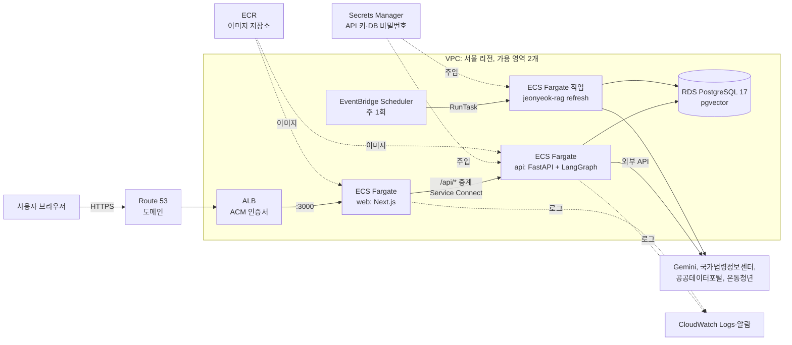

# AWS 배포 설계

> 2026-10-24 정리. **실제로 서버를 만들지는 않았고**, 이 서비스를 AWS에 올린다면 어떻게 할지를 설계해 둔 문서입니다.
> 요금은 서울 리전(ap-northeast-2) 기준 대략값입니다. 실제로 올리기 전에 [AWS 요금 계산기](https://calculator.aws/)로 다시 확인하세요.
> 서버 한 대에 지금 구성을 그대로 올리는 가장 싼 방법(Lightsail)은 [배포 가이드 4장](배포_가이드.md#4-방법-a-aws-lightsail-추천)에 있습니다.

## 1. 결론

| | 1단계: 서버 한 대 | 2단계: 관리형 서비스로 나누기 |
|---|---|---|
| 구성 | Lightsail 4GB 한 대에 `docker compose` + Caddy(HTTPS) | ECS Fargate(api·web) + RDS PostgreSQL(pgvector) + ALB + ACM |
| 월 비용 | 약 $24 (고정) | 약 $90~120 |
| 장점 | 로컬과 똑같이 돌아감. 싸고 단순함 | 서버 관리(OS 패치·디스크·재시작)가 없음. DB 백업·장애 조치를 AWS가 함. 서비스별로 따로 늘릴 수 있음 |
| 단점 | 서버가 죽으면 서비스도 멈춤. 백업·패치를 직접 함 | 비쌈. 설정할 것이 많음 |
| 언제 | 시연, 사용자가 적을 때 | 실제 사용자가 생기고 멈추면 안 될 때 |

이 문서는 **2단계**를 설계합니다. 지금 `docker-compose.yml`의 서비스 4개(`db`, `api`, `refresh`, `web`)가 AWS의 어디로 가는지가 핵심입니다.

## 2. 구성도



## 3. compose 서비스 → AWS 대응

| 지금 (`docker-compose.yml`) | AWS | 설정 | 이유 |
|---|---|---|---|
| `db` pgvector/pgvector:pg17 | **RDS for PostgreSQL 17**, db.t4g.small(2GB), gp3 20GB, 자동 백업 7일 | `CREATE EXTENSION vector;` (RDS가 pgvector를 지원함) | DB 크기 약 200MB, 대기 메모리 약 300MB. 백업·패치·장애 조치를 맡김 |
| `api` FastAPI | **ECS Fargate 서비스**, 1 vCPU / 2GB, **작업 1개** | uvicorn 워커 1개(지금 Dockerfile 그대로) | 대기 중 약 855MB(형태소 분석기 Kiwi만 약 500MB). 기한 알림 루프가 서버 안에서 한 시간마다 돌아서, 작업을 2개로 늘리면 알림이 두 번 갈 수 있음 |
| `refresh` (`--loop`, 7일마다) | **EventBridge Scheduler → ECS RunTask** (주 1회, `jeonyeok-rag refresh`) | `--loop` 없이 한 번 돌고 끝남 | 계속 켜 둘 필요가 없음. 도는 동안만 요금이 붙음 |
| `web` Next.js | **ECS Fargate 서비스**, 0.25 vCPU / 0.5GB, 작업 1~2개 | `API_URL=http://api:8000` (ECS Service Connect 이름) | 대기 중 약 80MB. 화면과 `/api/*` 중계만 함 |
| `ports: 3000:3000` | **ALB** + **ACM** 인증서(무료) + **Route 53** | 리스너 443 → web 대상 그룹, 80 → 443으로 넘김 | 알림(Web Push)·홈 화면 설치(PWA)는 HTTPS에서만 됨 |
| `backend/.env` | **Secrets Manager** (또는 SSM Parameter Store) | 작업 정의의 `secrets`로 환경 변수 주입 | 키를 이미지나 Git에 넣지 않음 |
| `docker compose logs` | **CloudWatch Logs** (awslogs 드라이버), 보관 30일 | | |
| `volumes: state` | 필요 없음 | 대화·프로필·작전도는 이미 Postgres에 저장 | 컨테이너를 언제 바꿔도 기록이 남음 |

## 4. 네트워크와 보안

- **VPC**: 가용 영역 2개, 서브넷은 공개(ALB)와 비공개(ECS·RDS)로 나눔.
- **보안 그룹**: 들어오는 연결을 바로 앞 단계에서만 받게 묶음.
  - ALB: 443·80을 전체에서
  - web: 3000을 ALB 보안 그룹에서만
  - api: 8000을 web 보안 그룹에서만 (밖에서 api로 바로 못 들어옴)
  - RDS: 5432를 api·refresh 보안 그룹에서만
- **밖으로 나가는 연결**: api·refresh는 Gemini·공공 API를 불러야 합니다. 비공개 서브넷이면 NAT 게이트웨이가 필요합니다(월 약 $45 + 데이터).
  - 비용을 줄이려면 ECS 작업을 공개 서브넷에 두고 공인 IP를 받되, 보안 그룹으로 들어오는 연결을 막는 방법도 있습니다. 비공개 서브넷보다 덜 안전하지만, 작은 서비스에서 자주 쓰는 타협입니다.
  - ECR·Secrets Manager·CloudWatch는 VPC 엔드포인트를 두면 NAT를 거치지 않습니다.
- **IAM**
  - 작업 실행 역할: ECR에서 이미지 받기, Secrets Manager 읽기, 로그 쓰기
  - 작업 역할: 앱이 AWS를 부르지 않으므로 거의 비워 둠
- **SSE 스트리밍**: 답변이 한 글자씩 SSE로 옵니다. 긴 답은 45초를 넘길 수 있어 **ALB 유휴 제한 시간을 60초(기본) → 120초**로 늘립니다.

## 5. 비밀값 (Secrets Manager)

| 이름 | 들어가는 값 |
|---|---|
| `jeonyeok/api-keys` | `GOOGLE_API_KEY`, `LAW_API_OC`, `DATA_GO_KR_SERVICE_KEY`, `YOUTHCENTER_API_KEY` |
| `jeonyeok/push` | `VAPID_PUBLIC_KEY`, `VAPID_PRIVATE_KEY`, `VAPID_SUBJECT`(`https://내도메인`) |
| `jeonyeok/admin` | `ADMIN_TOKEN` (운영용으로 새로 생성) |
| `jeonyeok/db` | RDS 만들 때 "Secrets Manager에서 관리" 선택 → 비밀번호 자동 생성·교체 |

`DATABASE_URL`은 작업 정의에서 RDS 주소와 위 비밀번호로 조합합니다. 일반 설정(`CHAT_RATE_LIMIT_PER_MINUTE`, `GEMINI_MODEL` 등)은 비밀값이 아니므로 `environment`에 둡니다.

## 6. 순서

1. **이미지 저장소**: ECR 저장소 `jeonyeok/api`, `jeonyeok/web` 만들기. 수명 주기 규칙으로 최근 10개만 남김.
2. **네트워크**: VPC(가용 영역 2개, 공개·비공개 서브넷) + 4장의 보안 그룹.
3. **DB**: RDS PostgreSQL 17 만들기(비공개 서브넷, 공개 접근 끔, 자동 백업 7일, 비밀번호는 Secrets Manager 관리).
4. **데이터 옮기기**: 자료를 서버에서 다시 모으면 시간과 임베딩 비용이 들어서, 로컬 DB를 덤프해 옮깁니다(약 200MB).
   ```bash
   # 로컬
   docker exec jeonyeok_helper-db-1 pg_dump -U jeonyeok -Fc jeonyeok > jeonyeok.dump
   # RDS는 비공개라, 같은 VPC의 임시 EC2(또는 SSM 포트 포워딩)를 거쳐 복원
   psql "$DATABASE_URL" -c "CREATE EXTENSION IF NOT EXISTS vector;"
   pg_restore -d "$DATABASE_URL" --no-owner --clean --if-exists jeonyeok.dump
   ```
   테스트용 사용자 기록은 비우고 검색 자료만 남깁니다([배포 가이드 2장](배포_가이드.md#데이터-옮기기)).
5. **비밀값**: 5장의 표대로 Secrets Manager에 저장.
6. **인증서·도메인**: Route 53에 도메인 → ACM에서 인증서 발급(DNS 검증).
7. **ECS 클러스터**: Fargate 클러스터 + Service Connect 이름 공간(`jeonyeok`).
8. **작업 정의 3개**: `api`, `web`, `refresh`(api 이미지에 명령만 `["jeonyeok-rag", "refresh"]`). api 작업 정의의 핵심 부분은 아래와 같습니다.
   ```json
   {
     "family": "jeonyeok-api",
     "requiresCompatibilities": ["FARGATE"],
     "cpu": "1024",
     "memory": "2048",
     "networkMode": "awsvpc",
     "containerDefinitions": [{
       "name": "api",
       "image": "<계정>.dkr.ecr.ap-northeast-2.amazonaws.com/jeonyeok/api:<커밋>",
       "portMappings": [{ "containerPort": 8000, "name": "api" }],
       "secrets": [
         { "name": "GOOGLE_API_KEY", "valueFrom": "arn:aws:secretsmanager:...:jeonyeok/api-keys:GOOGLE_API_KEY::" }
       ],
       "environment": [{ "name": "CHAT_RATE_LIMIT_PER_MINUTE", "value": "20" }],
       "healthCheck": {
         "command": ["CMD", "python", "-c", "import urllib.request; urllib.request.urlopen('http://127.0.0.1:8000/health', timeout=3)"],
         "startPeriod": 60
       },
       "logConfiguration": {
         "logDriver": "awslogs",
         "options": { "awslogs-group": "/ecs/jeonyeok-api", "awslogs-region": "ap-northeast-2", "awslogs-stream-prefix": "api" }
       }
     }]
   }
   ```
   DB 스키마는 api가 켜질 때 Alembic이 최신까지 올리므로 따로 마이그레이션 작업이 필요 없습니다.
9. **서비스**: `api`(작업 1개, Service Connect로 `api:8000` 공개) → `web`(ALB 대상 그룹에 연결, 상태 확인 `/`).
10. **ALB**: 443 리스너 → web, 80 → 443 넘김, 유휴 제한 시간 120초.
11. **자료 갱신 예약**: EventBridge Scheduler에서 `rate(7 days)`로 `refresh` 작업 실행.
12. **확인**: `https://도메인/api/health`, 그리고 [배포 가이드 6장](배포_가이드.md#6-배포-후-실테스트-체크리스트) 체크리스트.

## 7. 자동 배포 (GitHub Actions)

지금 `ci.yml`은 테스트·린트만 합니다. 배포를 붙이면 `main`에 합쳐질 때 다음이 돌게 합니다.

```
테스트 통과 → 이미지 빌드(태그 = 커밋 해시) → ECR에 올리기 → 작업 정의 새 버전 → ECS 서비스 롤링 배포
```

- AWS 키를 GitHub에 저장하지 않고 **OIDC**로 역할을 빌립니다(`aws-actions/configure-aws-credentials`). 역할 권한은 ECR 올리기와 해당 ECS 서비스 갱신만 줍니다.
- 롤링 배포 중 새 작업의 상태 확인이 실패하면 ECS가 이전 버전으로 되돌립니다(배포 서킷 브레이커).
- 되돌리기는 이전 작업 정의 버전으로 서비스를 바꾸면 됩니다. 다만 DB 마이그레이션이 들어간 변경은 앞으로만 적용되므로, 큰 변경 전에는 RDS 스냅샷을 먼저 찍습니다.

## 8. 운영

| 항목 | 방법 |
|---|---|
| 백업 | RDS 자동 백업 7일 + 큰 변경 전 수동 스냅샷 |
| 알람 | CloudWatch 알람: api CPU·메모리 80% 이상, ALB 5xx 증가, 대상 그룹 비정상 → SNS 메일 |
| 로그 | CloudWatch Logs 보관 30일. 단계별 소요 시간은 지금처럼 `/admin` 화면에서 봄 |
| 비용 | AWS Budgets 월 한도 알림. Gemini 사용료는 Google AI Studio에서 따로 한도를 걺 |
| 늘리기 | web은 작업 수를 늘리면 됨. api를 늘리려면 기한 알림 루프를 별도 예약 작업으로 빼고, 질문 답 저장(지금 서버 메모리)을 ElastiCache 등 공용 저장소로 옮겨야 함 |

## 9. 비용 (대략, 월)

| 항목 | 사양 | 대략 |
|---|---|---|
| Fargate api | 1 vCPU / 2GB, 24시간 | $40 안팎 |
| Fargate web | 0.25 vCPU / 0.5GB, 24시간 | $10 안팎 |
| Fargate refresh | 주 1회, 한 번에 수십 분 | $1 미만 |
| RDS | db.t4g.small, gp3 20GB, 단일 AZ | $30 안팎 |
| ALB | 1개, 적은 트래픽 | $20 안팎 |
| 그 밖 | ECR, CloudWatch, Secrets Manager, Route 53 | $5 안팎 |
| **합계** | NAT 게이트웨이 제외 | **약 $90~120** |

- NAT 게이트웨이를 쓰면 월 약 $45가 더 붙습니다(4장 참고).
- 1단계(Lightsail 4GB, 월 약 $24)보다 4~5배 비쌉니다. 그래서 사용자가 생기기 전에는 1단계로 충분하다고 판단했습니다.
- Gemini API 사용료는 별도이며 질문 수에 비례합니다(질문 하나에 모델 호출 5~8번).

## 10. 설계에서 정한 것

- **api는 작업 1개로 고정**: 기한 알림 루프와 같은 질문 답 저장이 서버 안에 있어서, 여러 개로 늘리면 알림이 겹치고 저장된 답이 서버마다 달라집니다. 늘릴 때 무엇을 빼야 하는지는 8장에 적었습니다.
- **refresh는 상시 서비스가 아니라 예약 작업**: compose에서는 `--loop`로 계속 켜 두지만, AWS에서는 도는 동안만 요금이 붙는 RunTask가 맞습니다.
- **DB만 관리형으로**: 컨테이너는 다시 띄우면 그만이지만, DB는 잃으면 복구가 어렵습니다. 비용을 줄여야 한다면 RDS를 빼지 말고 다른 곳을 줄입니다.
- **검색 자료는 덤프로 옮김**: 10,143 조각을 다시 임베딩하면 시간과 비용이 드니, 로컬에서 검증한 DB를 그대로 옮깁니다. 이후 개정분은 refresh가 바뀐 것만 다시 모읍니다.
