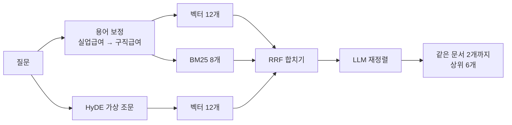

# 기술을 어떻게 썼고, 무엇이 나아졌나

기술마다 문제 → 적용 → 결과 순서로 적었습니다.

[← README로 돌아가기](../README.md)

### 1. 하이브리드 검색 (pgvector + BM25 + HyDE + 재정렬)

| | |
|---|---|
| **문제** | "군대 갔다온 거 연금에 쳐주나요" 같은 구어체는 "가입기간 추가 산입" 같은 조문 문장과 벡터 거리가 멀고, "공무상요양비"·"제25조"처럼 정확한 용어는 벡터 검색이 놓친다 |
| **적용** | ① 벡터 검색(gemini-embedding-001, pgvector) ② **HyDE**: 모델이 법령 문체의 가상 조문을 써서 한 번 더 검색 ③ **BM25**: Kiwi 형태소 분석(조사 제거) 키워드 검색 → 셋을 **RRF**로 합치고 ④ LLM **재정렬** 후 같은 문서는 2개까지 |
| **결과** | 골든셋 84문항 Hit@6 100%(당시 채점 기준), **Recall@6 99% → 100%** (BM25 추가). BM25 없이 놓치던 "휴가 중 사고, 민간병원" 질문의 공무상요양비 조문을 찾음 |
| **그래서 지금은** | 키워드 가중치를 0.3~1.0으로 비교해 근거를 하나도 놓치지 않은 1.0을 씀. BM25 색인(28MB)은 Postgres에 저장해 DB 지문(md5)이 같으면 다시 만들지 않음 |

- 조례는 사용자 지역 것만 찾습니다(지자체마다 비슷한 조례가 수백 개라 섞이면 법령이 밀려남).
- 600쪽짜리 안내서가 상위를 다 차지하던 문제를 "같은 문서 2개까지"로 막았습니다(제한 전 평가 24/30까지 하락).

### 2. 평가: 키워드 채점 + 검색 골든셋 + RAGAS

| | |
|---|---|
| **문제** | "좋아 보이는데"로는 프롬프트·자료를 바꿀 때 무엇이 망가졌는지 알 수 없다 |
| **적용** | ① 답변 평가 205문항(근거 출처·핵심 내용·되묻기·도구·프로필 추출·나오면 안 되는 말 채점. 전제가 틀린 질문 등 어려운 질문 34개, 가드레일 8개 포함) ② 검색 골든셋 84문항(Hit·Recall·MRR) ③ **RAGAS**: 근거 충실도·답변 관련성·자료 관련성 |
| **결과** | RAGAS가 키워드 채점이 놓친 문제를 찾음: 나라사랑가게 목록에 원문에 없는 "대상·내용"을 지어 넣음(근거 충실도 **0.09 → 0.97**), 위탁병원 목록에서 얼버무림(답변 관련성 **0 → 0.97**) |
| **그래서 지금은** | 기능을 바꾸면 세 평가를 다시 돌림. 평가를 63 → 205문항으로 늘리자 지어낸 전역일, 자격 질문을 검색 없이 답하는 문제가 새로 드러나 고침. 기능 9개를 더한 뒤 다시 돌린 결과 **202/205**, RAGAS 근거 충실도 0.879·답변 관련성 0.85·자료 관련성 0.947 |

- 정답은 검색 결과를 베끼지 않고 조문·쪽 내용으로 정했고, 금액·기한처럼 바뀌는 사실은 채점 기준에 넣지 않았습니다.
- 회귀를 실제로 잡았습니다: 프로필 추출 항목을 늘리자 41/41 → 37/41로 떨어져 되돌렸고, 자료를 늘리자 24/30까지 떨어져 원인(큰 문서가 법령을 밀어냄)을 고쳤습니다.

### 3. 환각 줄이기: 원문 기준 답변 · 근거 검증 · 원문 보기

| | |
|---|---|
| **문제** | 모델이 그럴듯한 금액·기한·자격·서류를 지어내고, 사용자는 답이 맞는지 확인할 방법이 없다 |
| **적용** | 답변 모델에는 **도구 원문**만 근거로 줌 → **verify 노드**가 초안 문장마다 원문에 있는지 대조해 고칠 문장만 돌려받음 → 기한은 출처에 그 문구가 있을 때만 남김. 출처마다 원문 발췌(최대 1,500자)와 시행일을 붙여 **[n]을 누르면 원문 패널**로 보여 줌. 신청 서류 목록은 **LLM이 만들지 않고** 민원 구비서류·법령·훈령 근거 그대로 데이터로 둠 |
| **결과** | 답변의 모든 출처 번호가 원문으로 열림(실제 답변 17번 확인). 서류 목록은 근거 자료에 적힌 것만 나옴 |

### 4. LangGraph 에이전트: 검색기가 아니라 길잡이

| | |
|---|---|
| **문제** | 사용자는 "무슨 혜택이 있는지"보다 "그래서 나는 뭘 해야 하지?"가 궁금하다. 인사에도 검색을 돌리면 느리다 |
| **적용** | 맨 앞에 **coach 노드**: 인사·진행 보고는 검색 없이 답하고, 자료가 필요한 질문만 supervisor로. 버튼(복무 형태 고르기, 했어요·어떻게 해요?, 서류 챙기기)은 **LLM이 아니라 규칙**으로 만들어 매번 같게 |
| **결과** | 인사·진행 보고는 2~3초. 버튼 두세 번으로 작전도 완성, "신청할래요"라고 하면 서류 도우미 버튼이 붙음 |

### 5. Human-in-the-loop (interrupt)

| | |
|---|---|
| **문제** | 정보가 모자라 되물으면 그래프가 끝나고, 사용자가 답하면 처음부터(프로필 → 라우팅 → 워커) 다시 돌았다 |
| **적용** | `ask_user`가 `interrupt()`로 멈추고, 사용자의 답을 API가 `Command(resume=답)`으로 넘겨 **멈춘 자리에서 이어 감**. 대화 상태는 Postgres 체크포인터에 남음 |
| **결과** | 되묻기 전에 찾은 자료를 다시 검색하지 않음(테스트로 워커 호출 1회 확인) |

### 6. MCP 실시간 도구 + 응답 저장

| | |
|---|---|
| **문제** | 혜택·채용·병원 목록은 계속 바뀌어 임베딩해 둘 수 없고, 매번 받으면 느리다 |
| **적용** | 정부24·온통청년·제대군인지원센터 채용·보훈 채용·보훈 위탁병원·나라사랑가게·관할 보훈청을 **MCP 서버 도구 10개**로 묶음. 응답은 메모리 + Postgres에 유효 시간(1~24시간) 동안 저장 |
| **결과** | 서버를 다시 켠 뒤 나라사랑가게 2,625건 **4.3초 → 0.2초**, 온통청년 3,264건 **4.2초 → 0.2초**. API가 실패하면 직접 찾아볼 기관 링크로 대체 |

### 7. 자료 자동 갱신

| | |
|---|---|
| **문제** | 법령이 개정돼도 다시 수집하기 전까지 예전 조문으로 답한다. 매번 전부 다시 임베딩하면 비용이 크다 |
| **적용** | 국가법령정보센터의 **개정 일련번호**를 저장해 두고 7일마다 목록 검색으로 비교해 **바뀐 법령·행정규칙·조례만** 다시 임베딩, 개정으로 없어진 조문·폐지 조례는 지움(한꺼번에 많이 사라지면 검색 오류로 보고 건너뜀). 끝나면 BM25 저장 + 검색 골든셋을 자동 실행해 점수를 DB에 기록하고 떨어지면 표시. 서버는 10분마다 색인 지문을 보고 새 색인으로 바꿔 끼움 |
| **결과** | 첫 실행에서 **실제 개정 9건**(4일 전 개정된 예비군 교육훈련 훈령, 시행 예정본이 들어가 있던 고용보험법 등)을 찾아 276개 조문 반영, Recall 유지. 나머지 537개는 번호만 기록해 다시 임베딩하지 않음. 답변에는 "2026.10.18 확인 자료"처럼 기준일 표시 |

### 8. 운영 대시보드로 병목 찾기 → 첫 화면 반응

| | |
|---|---|
| **문제** | 자료 질문은 첫 글자까지 13초 넘게 걸리는데, 어디가 느린지 감으로만 알았다 |
| **적용** | 질문마다 단계별로 끝난 시각·첫 글자·실패한 도구 호출을 기록(질문은 개인정보를 가려 앞부분만)하고 **관리자 화면**(👎 피드백·느린 단계·실패)으로 모아 봄. 병목: 답변 쓰기 7.3초, 법령 찾기 3.7초, 필요 없는 프로필 추출 1초 → 복무 정보 단서가 없는 질문은 프로필 추출을 건너뛰고(평가에서 프로필을 기대하는 66문항은 영향 없음), 워커가 찾은 자료를 답변 전에 먼저 보냄 |
| **결과** | 첫 화면에 내용이 보이기까지 약 13초 → **2.6~3.9초**, 첫 글자 중간값 13.1초 → 11.6초 (같은 6문항) |

그 전에 한 속도 개선: 규정·혜택 워커 동시 실행, 근거 검증은 고칠 문장만, 생각 예산 비교(27.1초 → 21.4초, 같은 정답률), 같은 질문 1시간 저장.

### 9. 계정 없는 서비스: 기록 지키기와 기한 알림

| | |
|---|---|
| **문제** | 누구나 바로 쓰게 하려고 로그인을 두지 않았다. 그러면 브라우저를 바꾸면 기록이 사라지고, 기한을 알려 줄 이메일도 없다 |
| **적용** | 기록: 파일 저장·불러오기, 짧은 **이어 하기 코드**(헷갈리는 글자를 뺀 8자, 약 8,500억 가지)와 QR, 브라우저 사본(서버 기록이 사라지면 복구). 기한: **.ics**(RFC 5545, 마감 7·1일 전 알림), **Web Push**(VAPID, 마감 30·7·1일 전, 밤에는 보내지 않고 놓친 알림은 하나만), **PWA**(홈 화면 설치, 아이폰 알림) |
| **결과** | 새 브라우저에서 파일·코드·QR로 완료 표시까지 이어짐을 확인. 캘린더 파일은 iCalendar 파서로, 웹 푸시는 가짜 브라우저 구독에 실제로 암호화·서명해 보내고 받는 쪽에서 복호화까지 테스트 |

### 10. 안정성과 보안

| 기술 | 적용 | 결과 |
|---|---|---|
| **가드레일** | 프롬프트 인젝션은 검색 전에 규칙으로 차단, 주민번호·카드번호·군번은 LLM과 대화 기록에 닿기 전에 가림 | 대화 기록(Postgres)에 원래 번호 0건. LLM 판단을 쓰지 않아 질문마다 1~2초 절약 |
| **TimeoutPolicy · RetryPolicy · error_handler** | 답변 노드 90초 제한, 끊긴 연결만 재시도, 실패 시 안내 문구로 종료. 워커는 노드 안에서 45초 제한 | 화면이 계속 도는 일 방지 (병렬 노드에서 error_handler가 동작하지 않는 것을 확인함) |
| **횟수 제한** | 채팅은 사용자별, 이어 하기 코드·관리자 열쇠는 접속 주소별 + **모두 합친 상한** | 중계 서버(Next) 뒤에서 모든 사용자를 한 사람으로 세던 문제와, 주소 머리글을 위조해 제한을 피하는 경우를 함께 막음 |
| **열린 중계 막기** | Next `/api/*`는 허용한 경로만, 머리글도 필요한 것만 넘김. 알림 주소는 알려진 푸시 서비스만 | 서버가 임의 주소로 요청을 보내지 않음 |
| **Postgres 체크포인터 · trim_messages** | 대화 기록·프로필을 Postgres로, LLM에는 최근 약 4,000토큰만 | 대화가 길어져도 속도·비용 일정 |
